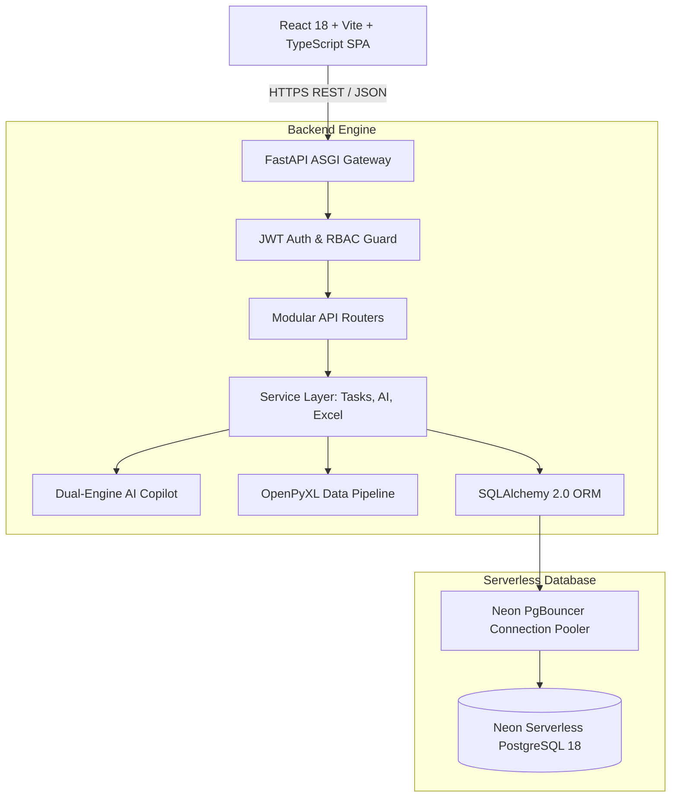

# Kairo — AI-Powered Task Management & To-Do Platform

[](https://www.python.org/)
[](https://fastapi.tiangolo.com/)
[](https://reactjs.org/)
[](https://www.typescriptlang.org/)
[-336791.svg)](https://neon.tech/)
[](https://tailwindcss.com/)
[](LICENSE)

An enterprise-grade, full-stack, AI-powered work orchestration and task management platform that transforms unstructured, error-prone spreadsheets into a secure, collaborative, multi-tenant productivity suite. *Do the right work at the right moment.*

**Watch the 20-second tour:** [`frontend/public/media/kairo-tour.mp4`](./frontend/public/media/kairo-tour.mp4) (also embedded on the landing page). Brand kit: [`docs/15_BRAND_KIT.md`](./docs/15_BRAND_KIT.md) or `/brand` in the app.

[](https://vercel.com/new/clone?repository-url=https%3A%2F%2Fgithub.com%2FHamzaviour%2FAI-Based-To-Do-App&env=JWT_SECRET_KEY,DATABASE_URL&envDescription=JWT_SECRET_KEY%3A%20long%20random%20string%20(openssl%20rand%20-hex%2032).%20DATABASE_URL%3A%20pooled%20Neon%20Postgres%20URL.&envLink=https%3A%2F%2Fgithub.com%2FHamzaviour%2FAI-Based-To-Do-App%2Fblob%2Fmain%2Fdocs%2F13_DEPLOYMENT_GUIDE.md)

| Route | What's there |
|---|---|
| `/` | Landing page with a live "Viewing as" scope demo and the video tour |
| `/login` | Sign in (`?demo=admin` / `?demo=user` pre-fills a demo account) |
| `/app` | The workspace (List, Kanban, Calendar, Projects, Analytics, Admin) |
| `/docs` | Interactive API documentation (Swagger) |

---

## 🌟 Key Highlights & Architectural Pillars

### 1. 🛡️ High-Assurance Security & IDOR Immunity
- **Inviolable Scope Filtering**: Mathematical protection against Insecure Direct Object Reference (IDOR). Regular users receive strict `404 Not Found` when probing unauthorized task UUIDs.
- **Stateless JWT with Token Rotation**: Short-lived 60-minute access tokens coupled with revocable, cryptographically hashed 7-day refresh tokens.
- **Salted Bcrypt Password Hashing**: Passwords stored using Blowfish salted hashing with cost factor 12.

### 2. 🤖 Dual-Engine AI Task Copilot
- **Natural Language Parsing**: Converts raw phrases (*"Submit Q4 budget report to Alex by next Thursday with urgent priority"*) into structured task entities.
- **Automated Subtask Decomposition**: Deconstructs high-level objectives into 3–7 actionable checklist items.
- **Explainable Prioritization**: Evaluates due date proximity, blocker weights, and capacity to deliver transparent prioritization scores with human-readable rationale.
- **Privacy-Scoped Context**: AI queries query strictly against the authenticated user's permitted tasks, eliminating data leakage across tenants.
- **Deterministic Heuristic Fallback**: 100% operational in air-gapped or offline environments without external API keys.

### 3. 📊 Omnichannel Task Orchestration
- **Dense Sortable List View**: Tabular layout with inline status selectors, bulk multi-selection, and fast filtering.
- **Interactive Kanban Board**: 6-column HTML5 drag-and-drop board with confetti celebration upon task completion.
- **Monthly Calendar**: Visual deadline tracking with clickable day event chips.
- **Slide-Over Task Drawer**: Subtasks checklist with live progress bar, threaded comments, and immutable audit logs.
- **Global Command Palette (`⌘K` / `Ctrl+K`)**: Instant task search and shortcut triggers.

### 4. 📑 Bidirectional Microsoft Excel Data Center
- **Dynamic Streaming Export**: Generates `.xlsx` spreadsheets complete with styled headers and native dropdown data validation.
- **Import Validation Preview**: Dry-run verification before committing imported spreadsheets to PostgreSQL.

---

## 🏗️ System Architecture



---

## 📂 Project Structure

```text
task-management-platform/
├── backend/
│   ├── app/
│   │   ├── api/          # REST route endpoints (Auth, Tasks, AI, Admin, Excel)
│   │   ├── core/         # Config, database connection pooling, security, deps
│   │   ├── models/       # Declarative SQLAlchemy 2.0 models (19 tables)
│   │   ├── schemas/      # Pydantic v2 validation DTOs and envelopes
│   │   └── services/     # Task isolation, AI engine, OpenPyXL pipeline
│   ├── migrations/       # SQL DDL schemas and triggers
│   ├── requirements.txt  # Python dependencies
│   ├── tests/            # Automated pytest suite (Auth, IDOR, AI, Excel)
│   └── run.py            # Uvicorn entrypoint
│
├── frontend/
│   ├── src/
│   │   ├── components/   # Layout, Tasks (List, Kanban, Calendar), AI, Excel
│   │   ├── context/      # Authentication & session provider
│   │   ├── services/     # Axios client with 401 refresh token interceptor
│   │   ├── pages/        # Landing page, Login (demo switcher) & Dashboard
│   │   └── types/        # TypeScript interfaces matching backend DTOs
│   ├── package.json
│   └── vite.config.ts
│
├── api/index.py          # Vercel serverless entrypoint (FastAPI)
├── vercel.json           # Build, routing and function config
├── scripts/seed_demo.py  # Schema bootstrap + demo data
├── graphify-out/         # Knowledge graph + Obsidian vault
├── brag-output/          # Launch video sources
│
└── docs/                 # Engineering & product documentation suite
    ├── 01_PRD.md
    ├── 02_TRD.md
    ├── 03_SRS.md
    ├── 04_SYSTEM_DESIGN_ARCHITECTURE.md
    ├── 05_UI_UX_DESIGN_SPEC.md
    ├── 06_IMPLEMENTATION_PLAN.md
    ├── 07_SDLC_METHODOLOGY.md
    ├── 08_PROJECT_TRACKING_TRACEABILITY.md
    └── 09_BACKEND_SCHEMA_SPEC.md
```

---

## 🚀 Quickstart Guide

### Prerequisites
- **Python 3.10+** (Python 3.14 supported)
- **Node.js 18+** & **npm**
- **Git**

### 1. Backend Setup
```bash
cd backend
python -m venv .venv
# On Windows:
.venv\Scripts\activate
# On macOS/Linux:
source .venv/bin/activate

pip install -r requirements.txt

# Point at any PostgreSQL database, then create the schema + demo data (idempotent)
export DATABASE_URL=postgresql://localhost:5432/kairo
python ../scripts/seed_demo.py

python run.py
```
Backend API will be live at `http://127.0.0.1:8000`.  
Interactive OpenAPI Swagger documentation: `http://127.0.0.1:8000/docs`.

### 2. Frontend Setup
```bash
cd frontend
npm install
npm run dev
```
Client SPA will be live at `http://localhost:5173`.

### 3. Running Automated Tests
```bash
cd backend
python -m pytest tests/ -v   # use a separate DATABASE_URL so demo data stays clean
```
*(21 integration, AI, Excel and IDOR security tests.)*

### 4. Deploy to Vercel
One project serves the static app from the CDN and the FastAPI backend as a Python function (`api/index.py`, routed by `vercel.json`). Add a Neon Postgres database and set `JWT_SECRET_KEY`, then deploy — full steps in **[docs/13_DEPLOYMENT_GUIDE.md](./docs/13_DEPLOYMENT_GUIDE.md)**.

---

## 🔑 Demo Credentials (Migrated from Excel)

| Account | Email | Password | Role / Scope |
|---|---|---|---|
| **Alexander Wright** | `alexander.wright@enterprise.com` | `P@ssw0rd!2026` | `admin` (System & Org-wide Scope) |
| **Sarah Jenkins** | `sarah.jenkins@enterprise.com` | `Secur3_Token#88` | `user` (Strictly Isolated Scope) |

---

## 📚 Engineering Documentation Suite

Detailed engineering documents are available in [`docs/`](./docs/):
- **[01_PRD.md](./docs/01_PRD.md)**: Product Requirements Document.
- **[02_TRD.md](./docs/02_TRD.md)**: Technical Requirements Document & API Route Registry.
- **[03_SRS.md](./docs/03_SRS.md)**: IEEE Std 830-1998 Software Requirements Specification.
- **[04_SYSTEM_DESIGN_ARCHITECTURE.md](./docs/04_SYSTEM_DESIGN_ARCHITECTURE.md)**: Architecture, Sequences, & IDOR filters.
- **[05_UI_UX_DESIGN_SPEC.md](./docs/05_UI_UX_DESIGN_SPEC.md)**: Linear/Notion design system tokens & component hierarchy.
- **[06_IMPLEMENTATION_PLAN.md](./docs/06_IMPLEMENTATION_PLAN.md)**: Work Breakdown Structure (WBS).
- **[07_SDLC_METHODOLOGY.md](./docs/07_SDLC_METHODOLOGY.md)**: Agile delivery & quality gates.
- **[08_PROJECT_TRACKING_TRACEABILITY.md](./docs/08_PROJECT_TRACKING_TRACEABILITY.md)**: Requirements Traceability Matrix (RTM).
- **[09_BACKEND_SCHEMA_SPEC.md](./docs/09_BACKEND_SCHEMA_SPEC.md)**: Comprehensive 19-table database dictionary.
- **[10_PRODUCT_PROPOSAL.md](./docs/10_PRODUCT_PROPOSAL.md)**: Problem, solution, rollout plan, risks and the decision requested. Also as a designed PDF: **[Kairo_Product_Proposal.pdf](./docs/Kairo_Product_Proposal.pdf)** (source in `docs/proposal/`).
- **[11_WORKFLOWS.md](./docs/11_WORKFLOWS.md)**: Task lifecycle, Excel onboarding, Copilot, isolation, admin and engineering/release workflows.
- **[12_USER_MANUAL.md](./docs/12_USER_MANUAL.md)**: How to use every part of Kairo, for users and admins.
- **[13_DEPLOYMENT_GUIDE.md](./docs/13_DEPLOYMENT_GUIDE.md)**: Vercel + Neon deployment, environment variables, operations.
- **[14_API_REFERENCE.md](./docs/14_API_REFERENCE.md)**: All 52 endpoints with access level (generated from the OpenAPI schema).
- **[15_BRAND_KIT.md](./docs/15_BRAND_KIT.md)**: Name, logo files and usage, colour, typography and voice. Live version at `/brand` in the app.

---

## 🕸️ Knowledge Graph (Obsidian)

The whole repository — code and docs — is mapped as a knowledge graph with [graphify](https://github.com/safishamsi/graphify) in [`graphify-out/`](./graphify-out/):

- **`graphify-out/obsidian/`** — open this folder as a vault in Obsidian (*Open folder as vault*) to browse one note per concept, linked by real relationships; `graph.canvas` shows the community layout.
- **`graphify-out/graph.html`** — the same graph, interactive in any browser.
- **`graphify-out/GRAPH_REPORT.md`** — communities, god nodes and surprising connections.

Refresh after code changes with `pip install graphifyy && graphify update .` (no API key needed).

## 🎬 Launch Video

The tour was produced with the [/brag](https://github.com/latent-spaces/brag) skill. Plan, share copy, poster and the frame/audio sources are in [`brag-output/`](./brag-output/); the soundtrack is original (synthesized), so it is free to reuse.

---

## 👤 Author & Contributor

**Hamza** ([@Hamzaviour](https://github.com/Hamzaviour))  
Email: [hamzavelous@gmail.com](mailto:hamzavelous@gmail.com)  
Project Repository: [AI-Based-To-Do-App](https://github.com/Hamzaviour/AI-Based-To-Do-App)
