<div align="center">

<picture>
  <source media="(prefers-color-scheme: dark)" srcset="./frontend/public/brand/kairo-lockup-dark.svg">
  
</picture>

### Do the right work at the right moment.

**Kairo turns the Excel tracker your team already runs on into a calm, secure, AI-assisted task workspace.**
Import the sheet, plan work from a sentence, and give every person a workspace scoped to exactly what they are allowed to see.

[](https://www.python.org/)
[](https://fastapi.tiangolo.com/)
[](https://react.dev/)
[](https://www.typescriptlang.org/)
[](https://neon.tech/)
[](https://groq.com/)
[](./backend/tests)
[](./LICENSE)

[Live demo accounts](#-demo-accounts) · [Quickstart](#-quickstart) · [Screenshots](#-screenshots) · [Docs](./docs) · [Brand kit](./docs/15_BRAND_KIT.md)

<br>

<a href="./frontend/public/media/kairo-tour.mp4">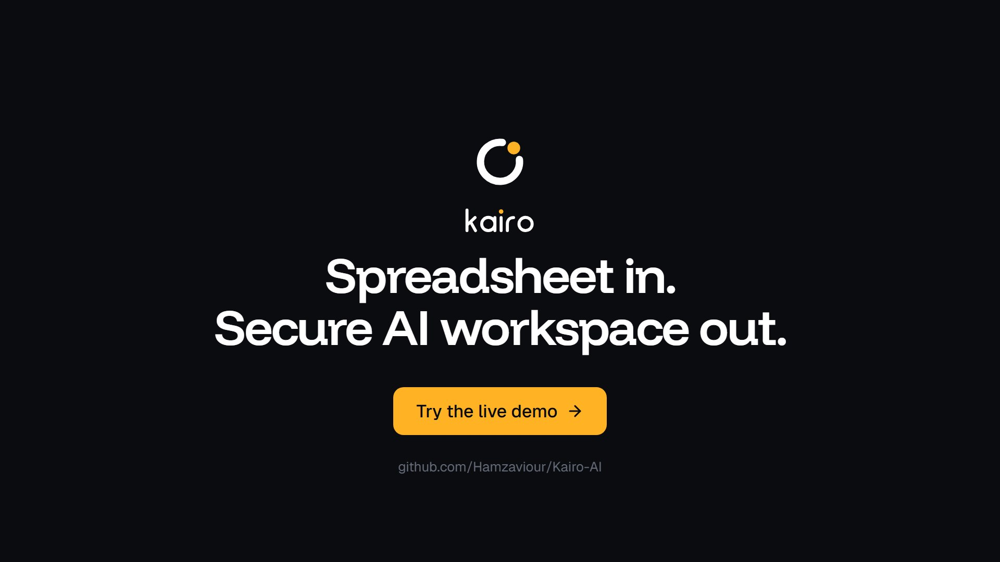</a>

<sub>▶ Click to watch the 20-second tour (MP4). It is also embedded on the landing page.</sub>

</div>

---

## Table of contents

- [Why Kairo](#-why-kairo)
- [Screenshots](#-screenshots)
- [Features](#-features)
- [Tech stack](#-tech-stack)
- [Architecture](#-architecture)
- [Quickstart](#-quickstart)
- [Environment variables](#-environment-variables)
- [Demo accounts](#-demo-accounts)
- [Testing](#-testing)
- [Deployment](#-deployment)
- [API overview](#-api-overview)
- [Project structure](#-project-structure)
- [Security](#-security)
- [Documentation](#-documentation)
- [Roadmap](#-roadmap)
- [Contributing](#-contributing)
- [License](#-license)
- [Author](#-author)

---

## 💡 Why Kairo

Teams that coordinate work in a shared spreadsheet pay for it every week:

| Pain in the shared workbook | What Kairo does instead |
|---|---|
| Everyone can read every row | Every query passes one scope filter; other people's tasks return **404** |
| Free-text statuses ("Pending", "Under Review?", blank) | Import preview maps legacy values and holds back broken rows |
| Rows without owners | Every task has an owner and a valid status after import |
| No history | Immutable activity log per task and an organisation-wide audit trail |
| People decide what to do next by scrolling | Copilot plans the day; chat assistants do the clicking for you |

*Kairo* comes from the Greek *kairos*: not clock time, but the right moment.

---

## 📸 Screenshots

<table>
  <tr>
    <td colspan="2" align="center"><b>Landing page</b><br>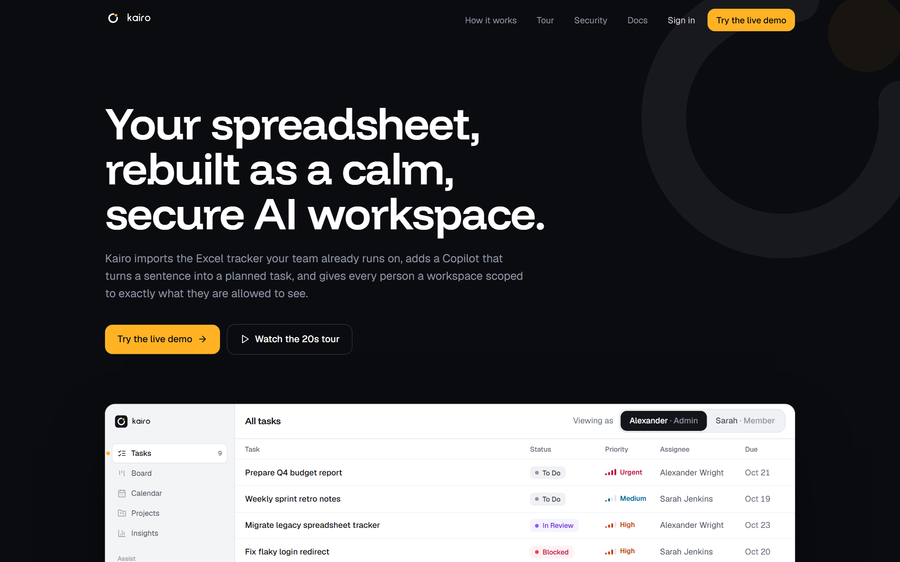</td>
  </tr>
  <tr>
    <td width="50%" align="center"><b>Live scope demo: same database, Sarah's view</b><br>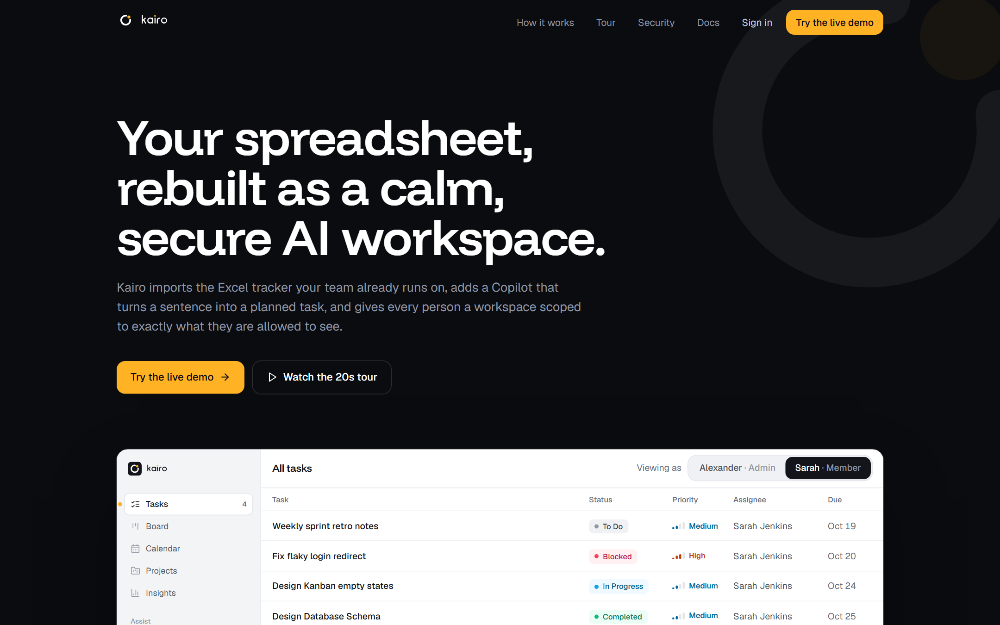</td>
    <td width="50%" align="center"><b>Sign in with demo accounts</b><br></td>
  </tr>
  <tr>
    <td align="center"><b>Workspace (admin)</b><br>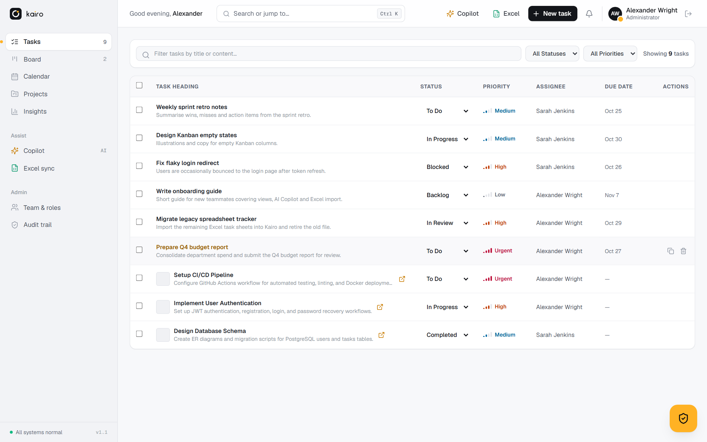</td>
    <td align="center"><b>Workspace (member, own tasks only)</b><br>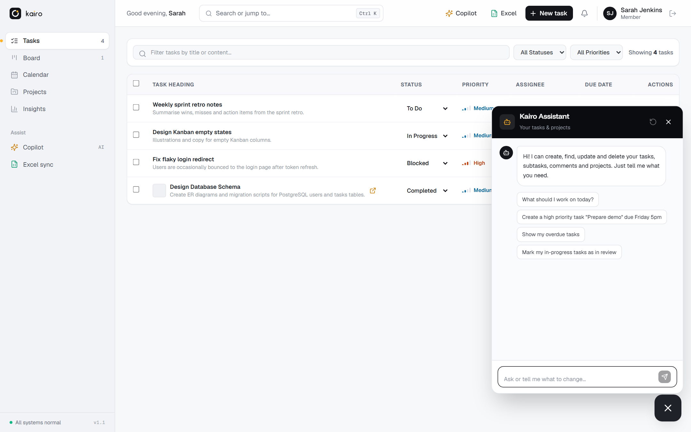</td>
  </tr>
  <tr>
    <td align="center"><b>Kanban board</b><br>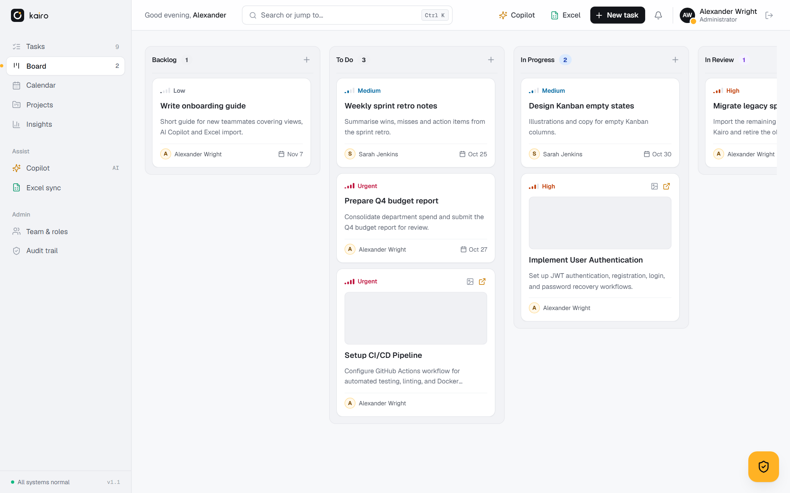</td>
    <td align="center"><b>Calendar</b><br>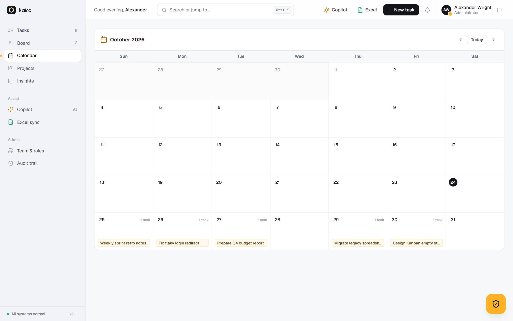</td>
  </tr>
  <tr>
    <td align="center"><b>Task drawer with explainable AI priority</b><br>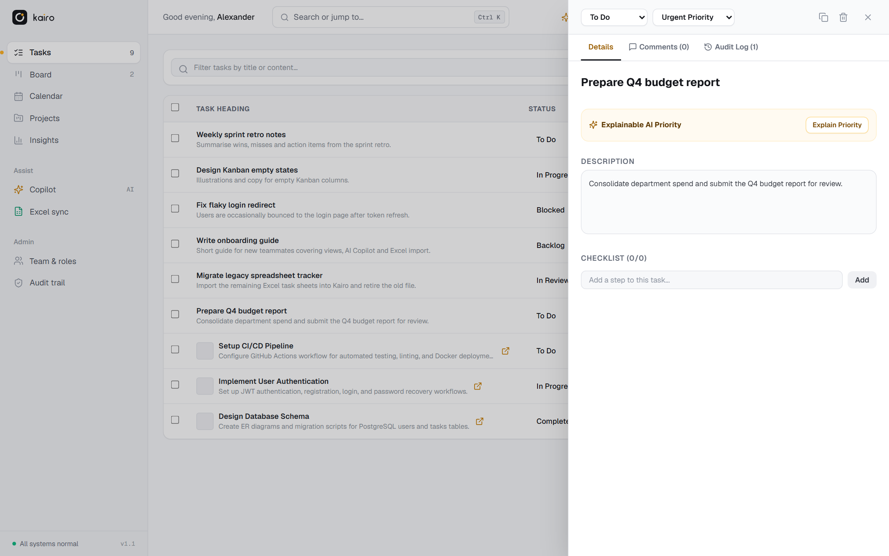</td>
    <td align="center"><b>Copilot</b><br>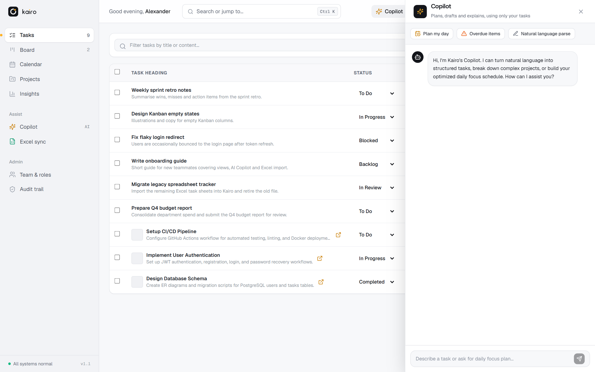</td>
  </tr>
  <tr>
    <td align="center"><b>Team &amp; roles (admin)</b><br>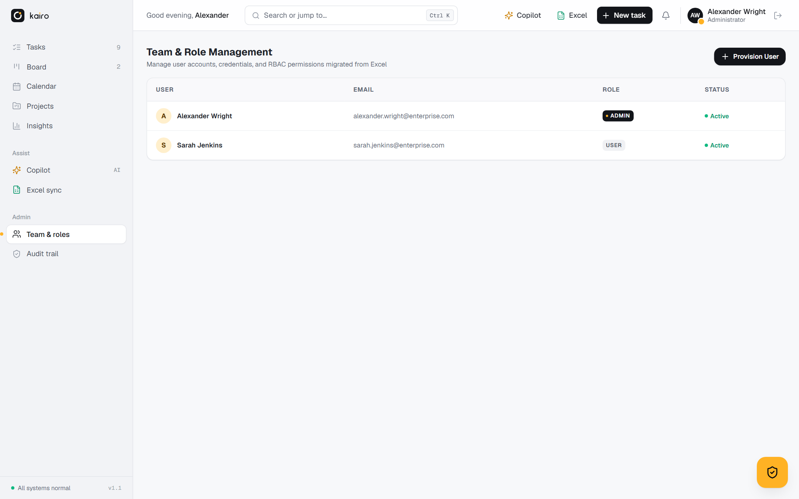</td>
    <td align="center"><b>Admin assistant with organisation-wide reach</b><br>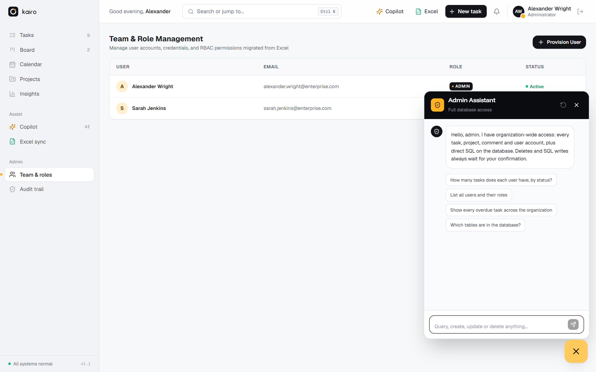</td>
  </tr>
  <tr>
    <td align="center"><b>Brand kit (<code>/brand</code>)</b><br>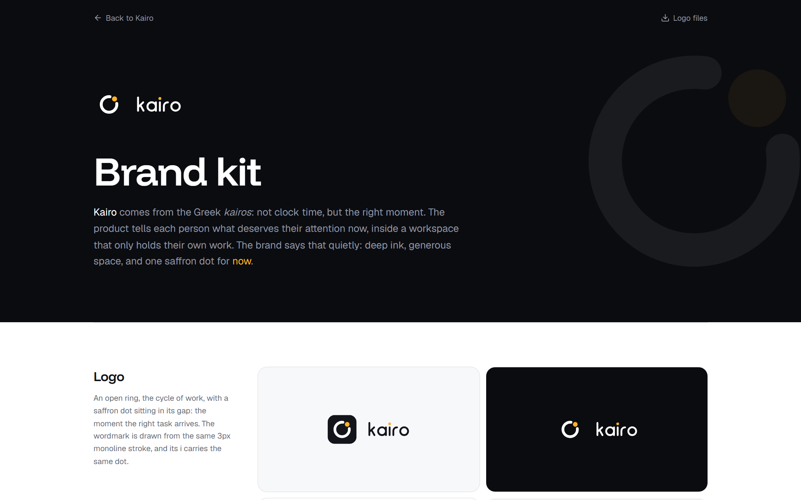</td>
    <td align="center"><b>Mobile</b><br>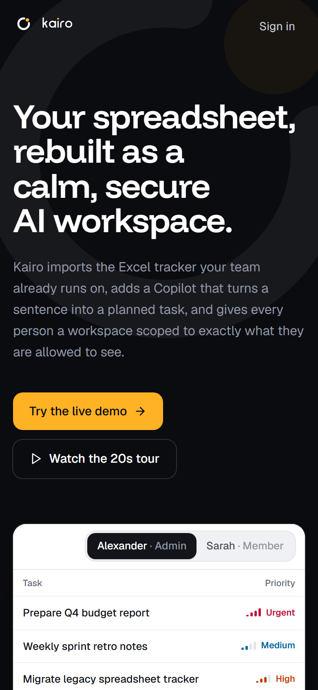</td>
  </tr>
</table>

<sub>Screenshots are generated from a running dev build with <code>python scripts/capture_screenshots.py</code>.</sub>

---

## ✨ Features

### 📑 Excel in, Excel out
- Upload an `.xlsx` and get a **dry-run import preview**: legacy statuses are normalised, rows missing a title are held back, nothing is written until you commit.
- **Styled export** back to Excel with native dropdown validation on status and priority, so stakeholders who still want a sheet keep one.

### 🛡️ Isolated workspaces
- One data-access scope filter (`get_scoped_tasks_query` / `get_task_or_404`) behind every task query.
- Members see only tasks they created, are assigned to, or share through a project. Probing anyone else's task ID returns **404, not 403**, so existence never leaks.
- Admins see the whole organisation, manage users and roles, and read the audit trail.

### 🤖 Copilot (works offline)
- Sentence in, structured task out: *"Submit Q4 budget report to Alex by next Thursday with urgent priority"* becomes a title, priority, due date and checklist.
- Subtask breakdown, explainable priority scoring, smart daily schedule and scoped Q&A.
- A deterministic engine runs with **no API key at all**.

### 💬 Chat assistants (Groq)
- A floating assistant in the bottom-right corner creates, finds, edits and closes **tasks, subtasks, comments and projects** from plain language.
- **Members** get an assistant scoped to their own work. **Admins** get their own, with organisation-wide reach, workload reports and member-account management. Admin accounts and role changes stay in the admin panel.
- **Guardrails:** neither assistant has direct database access. Requests for the database structure, SQL, source code, infrastructure, credentials or the system prompt, and prompt-injection attempts, are refused before they reach the model; replies are scanned and secrets redacted; tool calls only accept declared parameters; turns are rate-limited per user.
- Destructive actions wait for an explicit "yes", enforced on the server. Every turn, including blocked ones, is logged.
- Falls back to a smaller model on rate limits, then retries.

### 🗂️ Four ways to work
- Dense **list** with inline status, bulk actions and filters.
- Drag-and-drop **Kanban** board, monthly **calendar**, and a slide-over **task drawer** with checklist, comments and activity log.
- Global **`Ctrl/⌘ K`** command palette.

### 🎨 Designed, not decorated
- Calm premium interface: ink neutrals, one saffron accent for "now", Funnel Display + Geist type.
- Full brand kit with logo files at [`/brand`](./docs/15_BRAND_KIT.md).

---

## 🧰 Tech stack

| Layer | Technology |
|---|---|
| Frontend | React 18, TypeScript 5, Vite 6, Tailwind CSS 3, lucide-react, axios |
| Backend | FastAPI, SQLAlchemy 2, Pydantic v2, PyJWT, bcrypt, openpyxl, httpx |
| Database | PostgreSQL (Neon serverless), 19 tables, ENUM / JSONB types |
| AI | Offline heuristic Copilot · Groq (`openai/gpt-oss-120b`, fallback `openai/gpt-oss-20b`) for the assistants |
| Hosting | Vercel: static SPA on the CDN + FastAPI as one Python function |
| Testing | pytest + FastAPI TestClient (28 tests) |

---

## 🏗️ Architecture

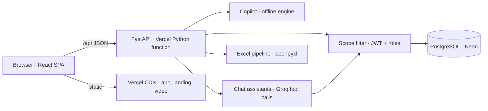

Every request that touches tasks, including the assistants' tool calls, passes the scope filter before it reaches the database. Details: [System design](./docs/04_SYSTEM_DESIGN_ARCHITECTURE.md) · [Database schema](./docs/09_BACKEND_SCHEMA_SPEC.md).

---

## 🚀 Quickstart

### Prerequisites
- **Python 3.10+**, **Node.js 18+** and npm, **Git**
- A **PostgreSQL** database (a free [Neon](https://neon.tech) project works)
- Optional: a **Groq API key** ([console.groq.com](https://console.groq.com/keys)) for the chat assistants

### 1. Clone

```bash
git clone https://github.com/Hamzaviour/Kairo-AI.git
cd Kairo-AI
```

### 2. Backend

```bash
cd backend
python -m venv .venv
.venv\Scripts\activate          # Windows
# source .venv/bin/activate     # macOS / Linux
pip install -r requirements.txt

cp ../.env.example .env         # then fill in DATABASE_URL, JWT_SECRET_KEY, GROQ_API_KEY
python ../scripts/seed_demo.py  # creates the schema + demo data (idempotent)
python run.py                   # http://127.0.0.1:8000  ·  Swagger at /docs
```

> The API also bootstraps an empty database on first start, so the seed step is only needed to restore demo rows.

### 3. Frontend

```bash
cd frontend
npm install
npm run dev                     # http://localhost:5173 (proxies /api to :8000)
```

Open `http://localhost:5173`, click **Try the live demo**, and you are in.

---

## 🔐 Environment variables

Set these in `backend/.env` locally, or in Vercel → Project Settings → Environment Variables.

| Variable | Required | Default | Purpose |
|---|---|---|---|
| `DATABASE_URL` | ✅ | — | PostgreSQL connection string (Neon's `POSTGRES_URL` is also accepted) |
| `JWT_SECRET_KEY` | ✅ in production | dev-only value | Signs access and refresh tokens. Startup fails on Vercel if left at the default |
| `GROQ_API_KEY` | for the assistants | empty | Enables the user and admin chat assistants |
| `GROQ_MODEL` | | `openai/gpt-oss-120b` | Primary assistant model |
| `GROQ_FALLBACK_MODEL` | | `openai/gpt-oss-20b` | Used when the primary model is rate-limited |
| `ACCESS_TOKEN_EXPIRE_MINUTES` | | `60` | Access token lifetime |
| `REFRESH_TOKEN_EXPIRE_DAYS` | | `7` | Refresh token lifetime |
| `CORS_ORIGINS` | | localhost ports | Comma-separated allowed origins |
| `ENVIRONMENT` | | `development` (`production` on Vercel) | Controls error detail in responses |

Never commit `.env`; it is ignored by git. See [`.env.example`](./.env.example).

---

## 🔑 Demo accounts

Both accounts come from the original Excel workbook.

| Account | Email | Password | Scope |
|---|---|---|---|
| **Alexander Wright** | `alexander.wright@enterprise.com` | `P@ssw0rd!2026` | Admin · whole organisation |
| **Sarah Jenkins** | `sarah.jenkins@enterprise.com` | `Secur3_Token#88` | Member · own tasks only |

`/login?demo=admin` and `/login?demo=user` pre-fill them. Sign in as each and compare what you can see.

---

## 🧪 Testing

```bash
cd backend
python -m pytest tests -q
```

28 tests cover authentication and token rotation, IDOR isolation (404 on other people's tasks), AI parsing, the chat assistants' permission and confirmation guards and guardrails, and the Excel round-trip. The suite writes test rows, so point `DATABASE_URL` at a separate database.

---

## ☁️ Deployment

[](https://vercel.com/new/clone?repository-url=https%3A%2F%2Fgithub.com%2FHamzaviour%2FKairo-AI&env=JWT_SECRET_KEY,DATABASE_URL,GROQ_API_KEY&envDescription=JWT_SECRET_KEY%3A%20long%20random%20string.%20DATABASE_URL%3A%20pooled%20Neon%20Postgres%20URL.%20GROQ_API_KEY%3A%20optional%2C%20for%20the%20chat%20assistants.&envLink=https%3A%2F%2Fgithub.com%2FHamzaviour%2FKairo-AI%2Fblob%2Fmain%2Fdocs%2F13_DEPLOYMENT_GUIDE.md)

One Vercel project serves the static app from the CDN and the FastAPI backend as a single Python function (`api/index.py`, routed by `vercel.json`).

1. Import the repository in Vercel.
2. Add a Neon Postgres database (or set `DATABASE_URL`).
3. Set `JWT_SECRET_KEY` (`openssl rand -hex 32`) and, optionally, `GROQ_API_KEY`.
4. Deploy. The first request bootstraps the schema and demo data.

Full guide: **[docs/13_DEPLOYMENT_GUIDE.md](./docs/13_DEPLOYMENT_GUIDE.md)**.

---

## 🔌 API overview

All endpoints live under `/api` and return `{ success, data, message, error, meta }`. Interactive docs at **`/docs`** (Swagger) and **`/redoc`**.

| Area | Examples |
|---|---|
| Auth | `POST /api/auth/login`, `POST /api/auth/refresh`, `GET /api/auth/me` |
| Tasks | `GET/POST /api/tasks`, `PUT/DELETE /api/tasks/{id}`, `PATCH /api/tasks/{id}/status`, bulk update, duplicate |
| Subtasks & comments | `/api/tasks/{id}/subtasks`, `/api/tasks/{id}/comments` |
| Projects | `GET/POST /api/projects`, members |
| AI | `/api/ai/parse-task`, `/breakdown`, `/prioritize`, `/smart-schedule`, `/chat` |
| Assistants | `POST /api/ai/assistant` (member), `POST /api/ai/admin-assistant` (admin) |
| Excel | `/api/excel/preview-import`, `/commit-import`, `/export` |
| Admin | `/api/admin/users`, `/api/admin/audit-logs` |

Every endpoint with its access level: **[docs/14_API_REFERENCE.md](./docs/14_API_REFERENCE.md)**.

---

## 📂 Project structure

```text
Kairo-AI/
├── backend/
│   ├── app/
│   │   ├── api/endpoints/   # auth, tasks, subtasks, comments, projects, ai, excel, admin, analytics
│   │   ├── core/            # config, database, security, deps, demo seed
│   │   ├── models/          # SQLAlchemy models (19 tables)
│   │   ├── schemas/         # Pydantic DTOs and the response envelope
│   │   └── services/        # scoped task service, Copilot, chat assistants, Excel pipeline
│   ├── migrations/          # SQL schema
│   ├── tests/               # pytest suite
│   └── run.py               # local entrypoint
├── frontend/
│   ├── public/              # favicon, brand logo files, tour video
│   └── src/
│       ├── components/      # layout, tasks, ai (Copilot + chat widget), brand, admin, excel
│       ├── pages/           # Landing, Login, Dashboard, Brand
│       ├── services/        # axios client with refresh-token rotation
│       └── context/         # auth provider
├── api/index.py             # Vercel serverless entrypoint
├── vercel.json              # build, routing, function config
├── scripts/                 # demo seed, Excel tools, screenshot capture
├── data/                    # original and migrated Excel workbooks
├── docs/                    # product + engineering docs, proposal PDF, screenshots
├── brag-output/             # tour video source (HTML frames + synthesized soundtrack)
└── graphify-out/            # knowledge graph + Obsidian vault of the repo
```

---

## 🛡️ Security

- **IDOR immunity:** scope filtering in the data layer; unauthorised task IDs return 404.
- **Tokens:** 60-minute access tokens, single-use rotating refresh tokens stored only as hashes, revoked at logout.
- **Passwords:** bcrypt with salt.
- **Assistants:** act through the same scoped services as the UI; deletes need explicit confirmation; no raw SQL or schema access; guardrails screen requests and replies; secrets and hashes are never sent to the model.
- **Production guard:** the API refuses to start on Vercel with the default JWT secret.

Found a vulnerability? Please email the author rather than opening a public issue.

---

## 📚 Documentation

| Document | Contents |
|---|---|
| [01_PRD](./docs/01_PRD.md) | Product requirements |
| [02_TRD](./docs/02_TRD.md) | Technical requirements and route registry |
| [03_SRS](./docs/03_SRS.md) | Software requirements specification |
| [04_SYSTEM_DESIGN_ARCHITECTURE](./docs/04_SYSTEM_DESIGN_ARCHITECTURE.md) | Architecture, sequences, isolation |
| [05_UI_UX_DESIGN_SPEC](./docs/05_UI_UX_DESIGN_SPEC.md) | Original UI/UX specification |
| [06_IMPLEMENTATION_PLAN](./docs/06_IMPLEMENTATION_PLAN.md) | Work breakdown structure |
| [07_SDLC_METHODOLOGY](./docs/07_SDLC_METHODOLOGY.md) | Delivery process and quality gates |
| [08_PROJECT_TRACKING_TRACEABILITY](./docs/08_PROJECT_TRACKING_TRACEABILITY.md) | Requirements traceability matrix |
| [09_BACKEND_SCHEMA_SPEC](./docs/09_BACKEND_SCHEMA_SPEC.md) | 19-table database dictionary |
| [10_PRODUCT_PROPOSAL](./docs/10_PRODUCT_PROPOSAL.md) | Problem, solution, rollout, risks · [designed PDF](./docs/Kairo_Product_Proposal.pdf) |
| [11_WORKFLOWS](./docs/11_WORKFLOWS.md) | Task lifecycle, Excel onboarding, Copilot, admin flows |
| [12_USER_MANUAL](./docs/12_USER_MANUAL.md) | How to use every part of Kairo |
| [13_DEPLOYMENT_GUIDE](./docs/13_DEPLOYMENT_GUIDE.md) | Vercel + Neon deployment and operations |
| [14_API_REFERENCE](./docs/14_API_REFERENCE.md) | Every endpoint with access level |
| [15_BRAND_KIT](./docs/15_BRAND_KIT.md) | Name, logo, colour, type, voice |
| [DESIGN.md](./DESIGN.md) · [PRODUCT.md](./PRODUCT.md) | Design system and product context |

**Knowledge graph:** open [`graphify-out/obsidian/`](./graphify-out/obsidian/) as an Obsidian vault, or [`graphify-out/graph.html`](./graphify-out/graph.html) in a browser.

---

## 🗺️ Roadmap

- [ ] Email and Slack notifications
- [ ] SSO / SAML sign-in
- [ ] Recurring-task UI
- [ ] Dark mode for the workspace
- [ ] Streaming assistant replies
- [ ] Multi-organisation tenancy

---

## 🤝 Contributing

1. Fork the repo and create a branch: `git checkout -b feature/your-idea`
2. Run the backend tests and `npx tsc --noEmit` in `frontend/`
3. Follow the design rules in [DESIGN.md](./DESIGN.md) for any UI change
4. Open a pull request describing what changed and why

---

## 📄 License

Released under the [MIT License](./LICENSE).

---

## 👤 Author

**Hamza Younas** · [@Hamzaviour](https://github.com/Hamzaviour) · [hamzavelous@gmail.com](mailto:hamzavelous@gmail.com)

If Kairo is useful to you, a ⭐ on the repo is appreciated.
