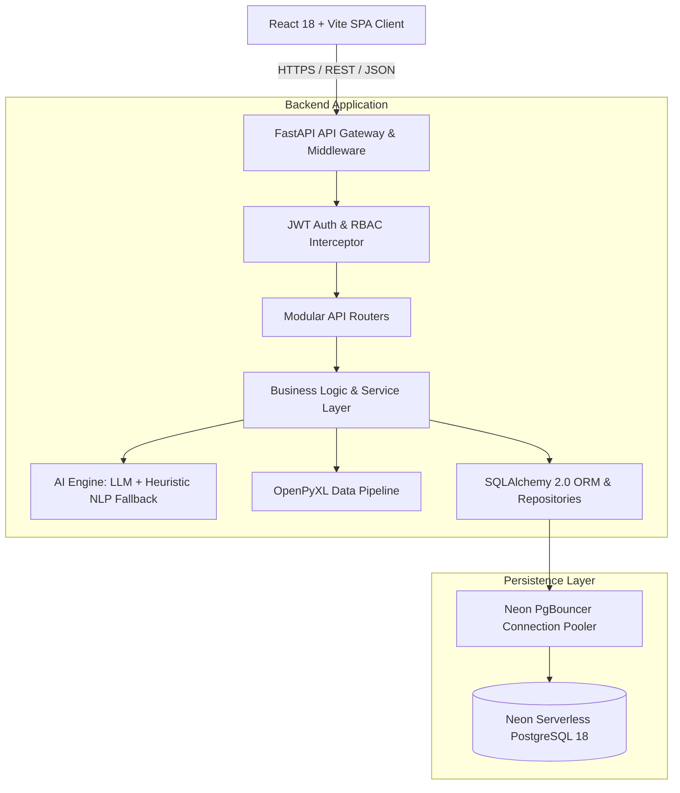
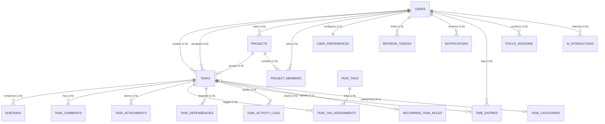
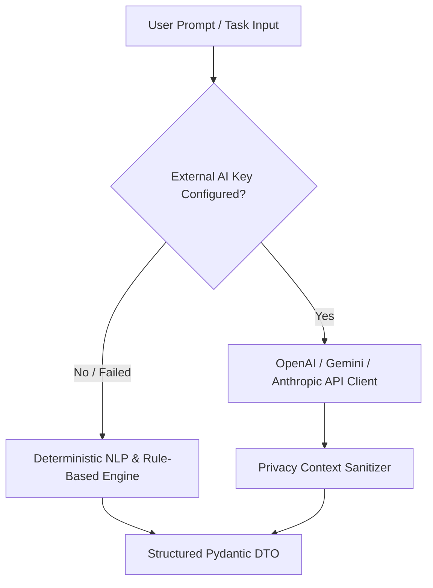
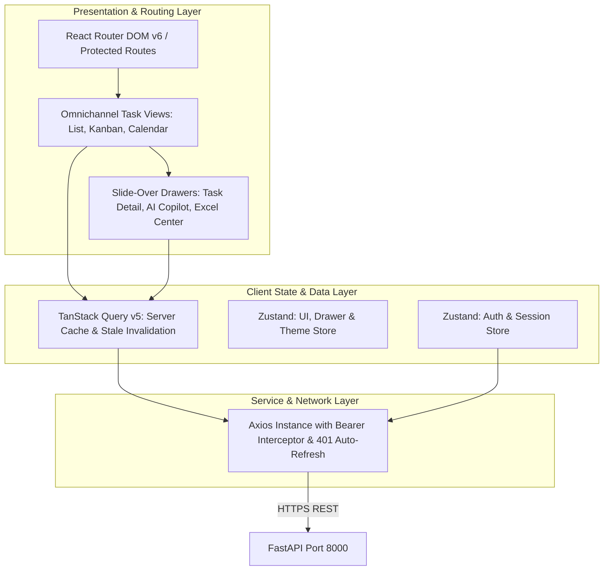

# Technical Requirements Document (TRD)
## Project: AI-Powered Task Management & To-Do Platform
**Document Version:** 1.0.0  
**Status:** Approved  
**Author:** Principal Systems Architect  
**Date:** October 2026  

---

## 1. System Architecture Overview

The platform adopts a decoupled, modern three-tier architecture with an asynchronous AI pipeline and enterprise relational persistence:



---

## 2. Technology Stack Specifications

| Layer | Component | Version | Rationale |
|---|---|---|---|
| **Frontend Framework** | React.js with Vite | 18.x / Vite 5.x | Instant HMR, minimal bundle footprint, standard component ecosystem. |
| **Language** | TypeScript | 5.x | Strict type safety across API DTOs and UI component states. |
| **Styling & UI** | Tailwind CSS + Lucide Icons | Latest | High-fidelity utility styling, micro-animations, accessible UI tokens. |
| **State & Data Fetching** | TanStack Query (React Query) | 5.x | Automatic caching, stale-while-revalidate, optimistic mutations. |
| **Backend Framework** | FastAPI (Python) | 0.115+ (Python 3.14) | Asynchronous ASGI speed, automated OpenAPI 3.1 generation, Pydantic v2 validation. |
| **ORM & Migrations** | SQLAlchemy | 2.0.50 | Fully typed declarative models, robust relation management, bulk query execution. |
| **Database** | Neon PostgreSQL | 18 (AWS us-east-2) | High-performance serverless SQL with auto-scaling compute and built-in connection pooling. |
| **Authentication** | PyJWT + Bcrypt | Latest | Industry standard stateless JWT auth with salted blowfish hashing. |
| **Excel Engine** | OpenPyXL | Latest | Native streaming read/write for `.xlsx` with formula & data validation retention. |

---

## 3. Database Architecture & Schema Specifications

The database schema utilizes **19 normalized tables**, **6 native PostgreSQL enum types**, **20 performance indexes**, and **7 trigger-based auto-updating timestamps**.

### 3.1 Data Dictionary & ER Relationships



### 3.2 Indexing Strategy
- **B-Tree Indexes**: Placed on all foreign keys (`creator_id`, `assignee_id`, `project_id`, `category_id`, `task_id`, `user_id`).
- **Composite Indexes**:
  - `(user_id, is_read)` on `notifications` for instant unread badge counts.
  - `(project_id, user_id)` unique composite index on `project_members`.
  - `(task_id, tag_id)` unique composite index on `task_tag_assignments`.
- **Temporal Sorting Indexes**: `created_at DESC` on `tasks`, `notifications`, `task_activity_logs`.

---

## 4. API & Authentication Architecture

### 4.1 Token Lifecycle & Security
1. **Login (`POST /api/auth/login`)**:
   - Compares plaintext password against `password_hash` using constant-time `bcrypt.checkpw`.
   - Generates an `access_token` (HS256, 60 minutes) containing `{ sub: user_id, role: role, exp, iat }`.
   - Generates a cryptographically random `refresh_token` (7 days), hashes it with SHA-256, and saves it in `refresh_tokens`.
2. **Refresh Rotation (`POST /api/auth/refresh`)**:
   - Validates the incoming refresh token.
   - Revokes the old refresh token record (`is_revoked = TRUE`).
   - Issues a newly generated refresh token and access token pair.
3. **Logout (`POST /api/auth/logout`)**:
   - Immediately revokes the active refresh token.

### 4.2 Data Isolation & Authorization Filters
Every API endpoint querying tasks or sensitive entities enforces strict scope filtering:
```python
def apply_task_scope(query, current_user: User):
    if current_user.role == "admin":
        return query  # Admins see all tasks
    
    # Regular users only see tasks they created, are assigned to,
    # or belong to projects they are an active member of
    user_project_ids = [pm.project_id for pm in current_user.project_memberships]
    return query.filter(
        or_(
            Task.creator_id == current_user.id,
            Task.assignee_id == current_user.id,
            Task.project_id.in_(user_project_ids)
        )
    )
```

---

## 5. AI Service Architecture

The AI module is built with a resilient **Dual-Engine Pattern**:



### 5.1 Privacy & Context Sanitization
When an AI endpoint processes user queries (e.g. *"What should I work on today?"*), the backend:
1. Queries the database using the authenticated user's exact authorization scope.
2. Formats only the user's permitted tasks into context strings.
3. Completely omits any data belonging to other users.
4. Logs the interaction into `ai_interactions` for traceability and audit.

### 5.2 Deterministic Fallback Engine
Guarantees 100% feature availability in offline, self-hosted, or air-gapped environments:
- **Task Parsing**: Regex and keyword extraction for priority, date offsets (*"tomorrow"*, *"next friday"*), and title detection.
- **Subtask Decomposition**: Rule-based templates matched against common task verbs (*"implement"*, *"setup"*, *"design"*, *"test"*, *"deploy"*).
- **Intelligent Prioritization**: Multi-factor scoring algorithm weighing deadline urgency, dependency blockers, and estimated duration.

---

## 6. Security & Threat Modeling (OWASP Top 10)

| Vulnerability | Mitigation Strategy |
|---|---|
| **A01: Broken Access Control** | Backend dependency injection (`get_current_active_user`, `get_current_admin`) checks role and data ownership on every single endpoint. |
| **A02: Cryptographic Failures** | Bcrypt cost factor 12 for passwords. TLS 1.3 enforced for Neon PostgreSQL connections. Secrets stored in `.env`. |
| **A03: Injection (SQL / NoSQL)** | 100% parameterized queries via SQLAlchemy 2.0 ORM. Raw string concatenation prohibited. |
| **A04: Insecure Design** | Principle of least privilege enforced; rate limiting configured on `/auth/login`; audit logging for all mutations. |
| **A05: Security Misconfiguration** | Strict CORS policy allowing only verified client origins; debug traces disabled in production mode. |

---

## 7. Performance & Scalability Targets

- **Connection Pool Optimization**: PgBouncer pooling via Neon with `pool_size=5` and `max_overflow=10` per backend instance to prevent connection exhaustion.
- **Query Optimization**: Eager loading (`joinedload` / `selectinload`) on foreign relationships to eliminate N+1 query bottlenecks on task lists.
- **Response Compression**: GZip middleware enabled on FastAPI for payloads > 1KB.

---

## 8. Frontend Technical Architecture & Client State Model



### 8.1 TanStack Query Key Discipline
- `['tasks', { status, priority, project_id, search, page }]`: Paginated task list query.
- `['tasks', taskId]`: Single task detail drawer query with nested subtasks and comments.
- `['projects']`: Workspace project roster.
- `['notifications', { unreadOnly }]`: Notification center badge and list query.
- `['analytics', 'user']` / `['analytics', 'admin']`: Productivity and organizational metrics.

### 8.2 Authentication Interceptor Flow
- Request interceptor attaches `Authorization: Bearer <access_token>`.
- Response interceptor traps `401 Unauthorized`. If not already refreshing:
  - Invokes `POST /api/auth/refresh` with persisted `refresh_token`.
  - Replays failed requests with new `access_token`.
  - On refresh rejection, purges session and redirects to `/login`.

---

## 9. Live API Route Registry

| HTTP Method | Path | Summary | Scope / Access |
|---|---|---|---|
| `GET` | `/api/health` | System health and Neon DB latency | Public |
| `POST` | `/api/auth/login` | User login & token generation | Public |
| `POST` | `/api/auth/register` | Account registration | Public |
| `POST` | `/api/auth/refresh` | Refresh token rotation | Public |
| `POST` | `/api/auth/logout` | Revoke active refresh token | Authenticated |
| `GET` | `/api/auth/me` | Fetch active user profile | Authenticated |
| `PUT` | `/api/auth/me` | Update active user profile | Authenticated |
| `PUT` | `/api/auth/preferences` | Update UI & notification preferences | Authenticated |
| `GET` | `/api/tasks` | Filtered, scoped task collection | User / Admin Scoped |
| `POST` | `/api/tasks` | Create task with subtasks & tags | Authenticated |
| `GET` | `/api/tasks/{id}` | Task detail with comments & logs | IDOR Scoped |
| `PUT` | `/api/tasks/{id}` | Update task fields | IDOR Scoped |
| `PATCH` | `/api/tasks/{id}/status` | Instant Kanban column transition | IDOR Scoped |
| `DELETE` | `/api/tasks/{id}` | Soft-delete / archive task | IDOR Scoped |
| `POST` | `/api/tasks/{id}/duplicate` | Clone task and checklist | IDOR Scoped |
| `POST` | `/api/tasks/bulk` | Bulk status/priority update | IDOR Scoped |
| `POST` | `/api/tasks/{id}/subtasks` | Append checklist subtask | IDOR Scoped |
| `PATCH` | `/api/subtasks/{id}` | Toggle subtask completed status | IDOR Scoped |
| `GET` | `/api/projects` | List visible projects | Member / Admin |
| `POST` | `/api/projects` | Create new project workspace | Authenticated |
| `GET` | `/api/tasks/{id}/comments` | Threaded task comments | IDOR Scoped |
| `POST` | `/api/tasks/{id}/comments` | Add comment to task | IDOR Scoped |
| `GET` | `/api/notifications` | User notifications feed | User Scoped |
| `PATCH` | `/api/notifications/{id}/read` | Mark alert as read | User Scoped |
| `POST` | `/api/ai/parse-task` | Natural language -> task DTO | Authenticated |
| `POST` | `/api/ai/breakdown` | Deconstruct task into subtasks | Authenticated |
| `POST` | `/api/ai/prioritize` | Explainable priority recommendation | Authenticated |
| `POST` | `/api/ai/smart-schedule` | Generate optimized daily schedule | Authenticated |
| `POST` | `/api/ai/chat` | Private context-aware task chat | User Scoped |
| `GET` | `/api/analytics/user` | Personal velocity & streak metrics | User Scoped |
| `GET` | `/api/analytics/admin` | Org-wide workload & completion velocity | Admin Only |
| `GET` | `/api/admin/users` | List all users and roles | Admin Only |
| `POST` | `/api/admin/users` | Provision user account | Admin Only |
| `GET` | `/api/admin/audit-logs` | Immutable audit log trail | Admin Only |
| `GET` | `/api/excel/export` | Download dynamic `.xlsx` file | User / Admin Scoped |
| `POST` | `/api/excel/preview-import` | Upload Excel for schema validation | Authenticated |
| `POST` | `/api/excel/commit-import` | Commit validated preview records | Authenticated |

