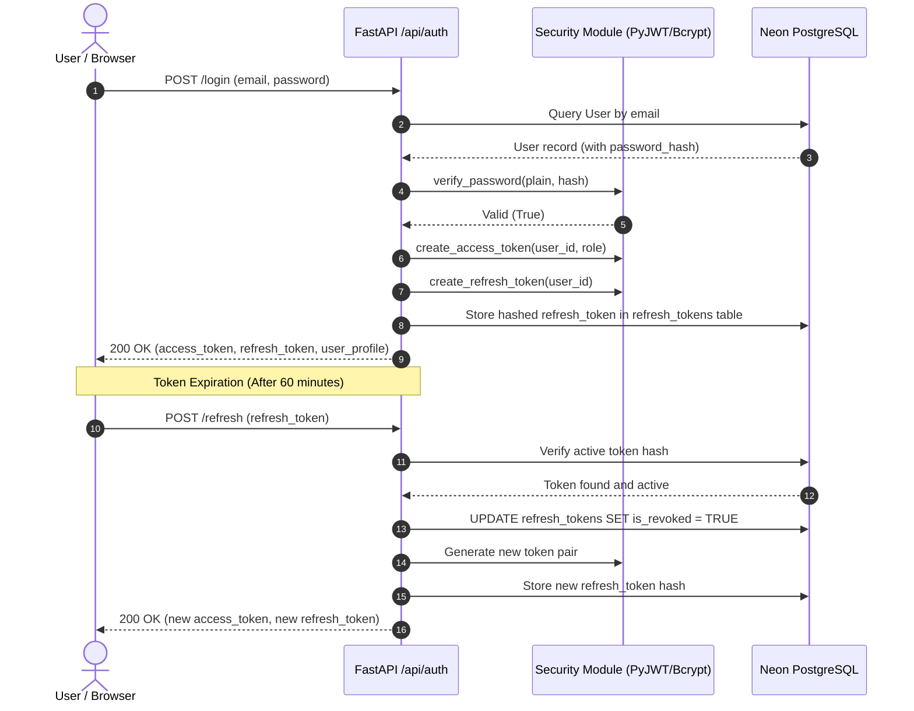
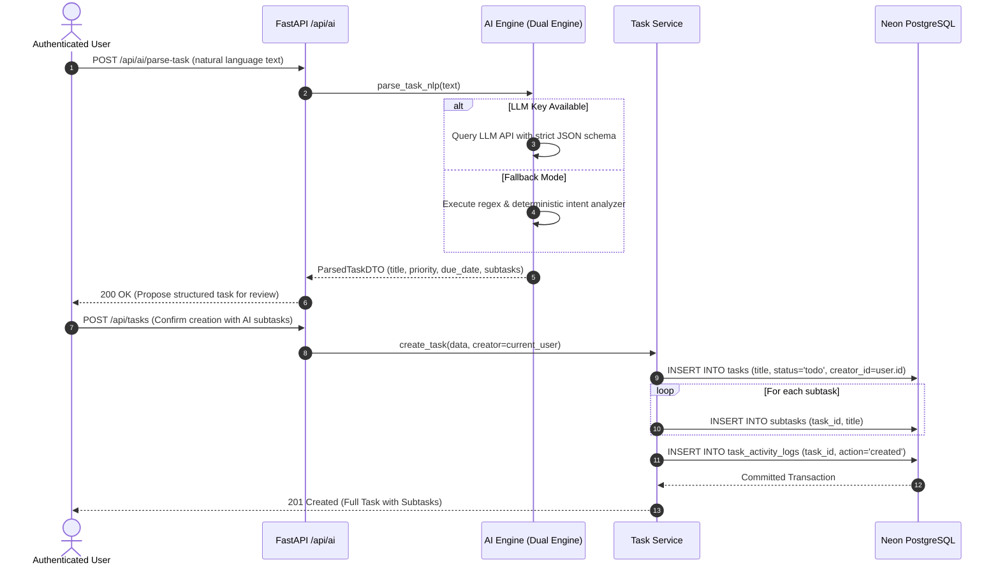
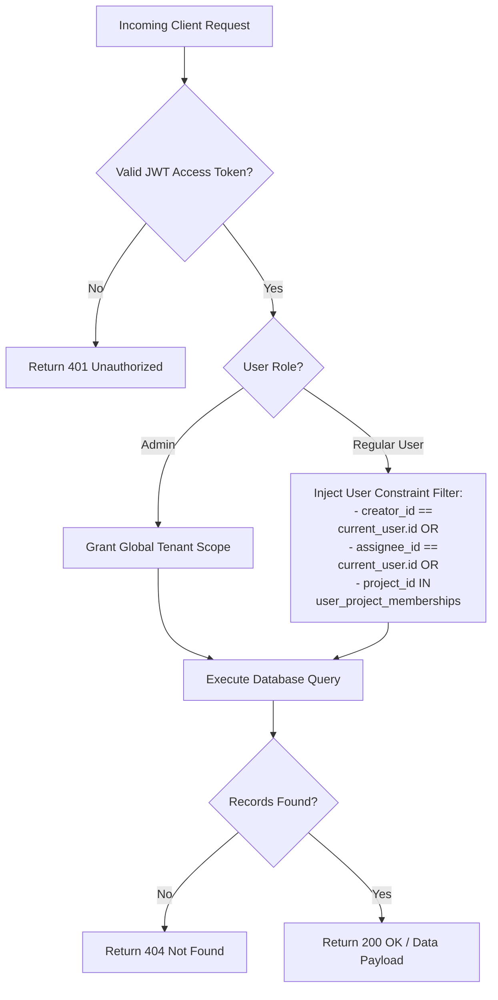
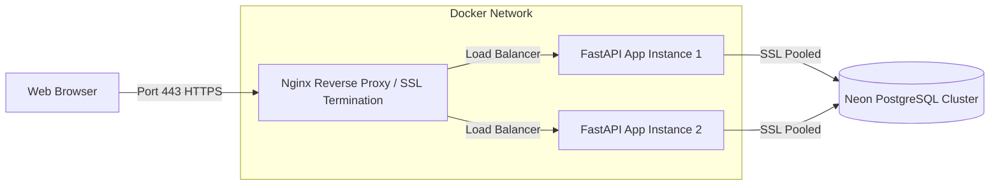

# System Design & Architecture Document
## Project: AI-Powered Task Management & To-Do Platform
**Document Version:** 1.0.0  
**Status:** Approved  
**Author:** Chief Technology Architect  
**Date:** October 2026  

---

## 1. Architectural Philosophy & Patterns

The platform implements **Clean Layered Architecture** with distinct separation of concerns:

```
┌─────────────────────────────────────────────────────────────┐
│                 Presentation Layer (React SPA)              │
└──────────────────────────────┬──────────────────────────────┘
                               │ HTTPS / JSON REST
┌──────────────────────────────▼─────────────────────────────┐
│                API Routing Layer (FastAPI Routers)          │
│          - Request Validation (Pydantic v2 DTOs)            │
│          - Authentication & Authorization Dependencies      │
└──────────────────────────────┬──────────────────────────────┘
                               │
┌──────────────────────────────▼─────────────────────────────┐
│                     Service Layer (Business Logic)         │
│          - Scope resolution & permission enforcement       │
│          - Event logging, notifications & triggers         │
│          - AI pipeline orchestration & fallback            │
└──────────────────────────────┬──────────────────────────────┘
                               │
┌──────────────────────────────▼─────────────────────────────┐
│               Data Access Layer (SQLAlchemy 2.0 ORM)        │
│          - Declarative Models, Queries & Transactions       │
│          - Database Session Lifecycle Management            │
└──────────────────────────────┬──────────────────────────────┘
                               │ Connection Pool (PgBouncer)
┌──────────────────────────────▼─────────────────────────────┐
│               Persistence Layer (Neon PostgreSQL 18)        │
└─────────────────────────────────────────────────────────────┘
```

---

## 2. Sequence Diagrams

### 2.1 Authentication & Token Rotation Sequence



---

### 2.2 Private Context-Aware AI Task Creation Sequence



---

## 3. Data Flow & Authorization Enforcement

To prevent Insecure Direct Object Reference (IDOR), the backend uses an **inviolable scope filter**:



---

## 4. Error Handling Strategy & Standard API Envelope

Every API response adheres to a predictable schema:

### 4.1 Success Response Envelope
```json
{
  "success": true,
  "data": { ... },
  "message": "Operation completed successfully",
  "meta": {
    "timestamp": "2026-10-18T12:00:00Z",
    "request_id": "req_88f91a2e"
  }
}
```

### 4.2 Standard Error Response Envelope
```json
{
  "success": false,
  "error": {
    "code": "TASK_NOT_FOUND",
    "message": "Task does not exist or you do not have permission to access it",
    "details": []
  },
  "meta": {
    "timestamp": "2026-10-18T12:00:00Z"
  }
}
```

---

## 5. Deployment & Container Topology


