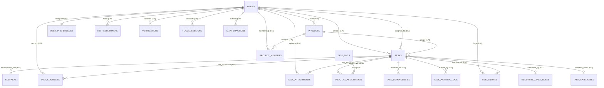

# Backend Database Schema & Data Dictionary Specification
## Project: AI-Powered Task Management & To-Do Platform
**Document Version:** 1.0.0  
**Database Engine:** PostgreSQL 18 (Serverless on Neon Cloud, AWS us-east-2)  
**Database Name:** `neondb` (Project: `orange-snow-72696664`)  
**Status:** Implemented & Verified in Production  
**Date:** October 2026  

---

## 1. Schema Architecture & Design Philosophy

The backend persistence layer is engineered with strict adherence to **Third Normal Form (3NF)** while optimizing for high-throughput transactional queries via strategic indexing:

1. **Deterministic Identity (UUIDv4)**: Every primary key uses universally unique identifiers (`uuid_generate_v4()`), completely eliminating auto-increment enumeration exploits (IDOR).
2. **UTC Timestamp Discipline**: All temporal columns use `TIMESTAMPTZ` with server-level default `NOW()`. Client timezones are respected via per-user preference offsets.
3. **Automated Audit Triggers**: An active database trigger automatically updates `updated_at` timestamps on row mutation across all core entities.
4. **Strong Typing via Native Enums**: Categorical values (roles, statuses, priorities, notification types, dependency types, recurrence rules) are governed by native PostgreSQL enum types.
5. **Cryptographic Integrity**: Authentication hashes utilize `pgcrypto` salted blowfish (`bcrypt`), ensuring secrets are never stored or logged in plain text.

---

## 2. PostgreSQL Native Enum Definitions

```sql
-- User authorization roles
CREATE TYPE user_role AS ENUM ('admin', 'user');

-- Task lifecycle states
CREATE TYPE task_status AS ENUM (
    'backlog', 'todo', 'in_progress', 'in_review', 'blocked', 'completed'
);

-- Task importance tiers
CREATE TYPE task_priority AS ENUM ('low', 'medium', 'high', 'urgent');

-- System notification categories
CREATE TYPE notification_type AS ENUM (
    'task_assigned', 'task_updated', 'task_completed', 'task_overdue',
    'comment_added', 'mention', 'deadline_approaching', 'system'
);

-- Inter-task dependency relationships
CREATE TYPE dependency_type AS ENUM ('blocks', 'blocked_by', 'relates_to');

-- Automated recurring schedule frequencies
CREATE TYPE recurrence_type AS ENUM (
    'daily', 'weekly', 'biweekly', 'monthly', 'yearly', 'custom'
);
```

---

## 3. Entity-Relationship (ER) Architecture



---

## 4. Comprehensive Data Dictionary (All 19 Tables)

### Domain A: Identity, Access & User Preferences

#### 4.1 Table: `users`
Core user identity and credential table.
| Column | Type | Constraints | Description |
|---|---|---|---|
| `id` | `UUID` | `PRIMARY KEY DEFAULT uuid_generate_v4()` | Unique user identifier |
| `name` | `VARCHAR(255)` | `NOT NULL` | Full legal or display name |
| `email` | `VARCHAR(255)` | `NOT NULL UNIQUE INDEX` | Unique login email address |
| `password_hash` | `VARCHAR(255)` | `NOT NULL` | Salted bcrypt password hash |
| `role` | `user_role` | `NOT NULL DEFAULT 'user'` | RBAC classification (`admin` \| `user`) |
| `profile_pic` | `TEXT` | `NULLABLE` | URL to CDN hosted avatar image |
| `is_active` | `BOOLEAN` | `NOT NULL DEFAULT TRUE` | Active account toggle |
| `timezone` | `VARCHAR(100)` | `DEFAULT 'UTC'` | User IANA timezone string |
| `created_at` | `TIMESTAMPTZ` | `NOT NULL DEFAULT NOW()` | Record creation timestamp |
| `updated_at` | `TIMESTAMPTZ` | `NOT NULL DEFAULT NOW()` | Trigger-managed update timestamp |

#### 4.2 Table: `user_preferences`
Personal UI ergonomics, working hours, and notification filters.
| Column | Type | Constraints | Description |
|---|---|---|---|
| `id` | `UUID` | `PRIMARY KEY DEFAULT uuid_generate_v4()` | Unique preference identifier |
| `user_id` | `UUID` | `NOT NULL UNIQUE REFERENCES users(id) ON DELETE CASCADE` | 1-to-1 owner relationship |
| `theme` | `VARCHAR(20)` | `NOT NULL DEFAULT 'light'` | Theme (`light` \| `dark` \| `system`) |
| `notifications_enabled` | `BOOLEAN` | `NOT NULL DEFAULT TRUE` | Global in-app notification switch |
| `email_notifications` | `BOOLEAN` | `NOT NULL DEFAULT FALSE` | Email notification switch |
| `daily_summary` | `BOOLEAN` | `NOT NULL DEFAULT TRUE` | Morning AI briefing flag |
| `weekly_summary` | `BOOLEAN` | `NOT NULL DEFAULT TRUE` | End-of-week analytics flag |
| `default_task_view` | `VARCHAR(50)` | `NOT NULL DEFAULT 'list'` | Initial view (`list` \| `kanban` \| `calendar`) |
| `pomodoro_duration` | `INTEGER` | `NOT NULL DEFAULT 25` | Work session duration (minutes) |
| `break_duration` | `INTEGER` | `NOT NULL DEFAULT 5` | Short break duration (minutes) |
| `working_hours_start` | `TIME` | `DEFAULT '09:00'` | Workday start boundary |
| `working_hours_end` | `TIME` | `DEFAULT '17:00'` | Workday end boundary |
| `created_at` | `TIMESTAMPTZ` | `NOT NULL DEFAULT NOW()` | Record creation timestamp |
| `updated_at` | `TIMESTAMPTZ` | `NOT NULL DEFAULT NOW()` | Auto-updated timestamp |

#### 4.3 Table: `refresh_tokens`
Stateless token revocation and multi-device session tracking.
| Column | Type | Constraints | Description |
|---|---|---|---|
| `id` | `UUID` | `PRIMARY KEY DEFAULT uuid_generate_v4()` | Unique session identifier |
| `user_id` | `UUID` | `NOT NULL REFERENCES users(id) ON DELETE CASCADE INDEX` | Associated user |
| `token_hash` | `VARCHAR(255)` | `NOT NULL UNIQUE INDEX` | SHA-256 hash of refresh token |
| `expires_at` | `TIMESTAMPTZ` | `NOT NULL` | Absolute token expiry time |
| `device_info` | `TEXT` | `NULLABLE` | Client User-Agent and IP string |
| `is_revoked` | `BOOLEAN` | `NOT NULL DEFAULT FALSE` | Token revocation status |
| `created_at` | `TIMESTAMPTZ` | `NOT NULL DEFAULT NOW()` | Session establishment time |

---

### Domain B: Projects & Categorization

#### 4.4 Table: `projects`
Workspaces grouping related tasks and milestones.
| Column | Type | Constraints | Description |
|---|---|---|---|
| `id` | `UUID` | `PRIMARY KEY DEFAULT uuid_generate_v4()` | Project identifier |
| `name` | `VARCHAR(255)` | `NOT NULL` | Project name |
| `description` | `TEXT` | `NULLABLE` | Project charter or scope description |
| `color` | `VARCHAR(7)` | `DEFAULT '#6366f1'` | Hex color badge indicator |
| `icon` | `VARCHAR(50)` | `NULLABLE` | Lucide icon identifier |
| `owner_id` | `UUID` | `NOT NULL REFERENCES users(id) ON DELETE CASCADE` | Project creator/owner |
| `is_archived` | `BOOLEAN` | `NOT NULL DEFAULT FALSE` | Project active status |
| `created_at` | `TIMESTAMPTZ` | `NOT NULL DEFAULT NOW()` | Creation timestamp |
| `updated_at` | `TIMESTAMPTZ` | `NOT NULL DEFAULT NOW()` | Auto-updated timestamp |

#### 4.5 Table: `project_members`
Collaborative many-to-many membership mapping.
| Column | Type | Constraints | Description |
|---|---|---|---|
| `id` | `UUID` | `PRIMARY KEY DEFAULT uuid_generate_v4()` | Membership identifier |
| `project_id` | `UUID` | `NOT NULL REFERENCES projects(id) ON DELETE CASCADE` | Associated project |
| `user_id` | `UUID` | `NOT NULL REFERENCES users(id) ON DELETE CASCADE` | Assigned team member |
| `role` | `VARCHAR(50)` | `NOT NULL DEFAULT 'member'` | Project role (`lead` \| `member` \| `viewer`) |
| `joined_at` | `TIMESTAMPTZ` | `NOT NULL DEFAULT NOW()` | Membership grant timestamp |
*Table Constraint*: `UNIQUE(project_id, user_id)`

#### 4.6 Table: `task_categories`
High-level operational categories (e.g., Engineering, Marketing, Operations).
| Column | Type | Constraints | Description |
|---|---|---|---|
| `id` | `UUID` | `PRIMARY KEY DEFAULT uuid_generate_v4()` | Category identifier |
| `name` | `VARCHAR(100)` | `NOT NULL UNIQUE` | Category label |
| `color` | `VARCHAR(7)` | `DEFAULT '#8b5cf6'` | Visual indicator color |
| `icon` | `VARCHAR(50)` | `NULLABLE` | Icon reference |
| `created_at` | `TIMESTAMPTZ` | `NOT NULL DEFAULT NOW()` | Creation timestamp |

#### 4.7 Table: `task_tags` & `task_tag_assignments`
Flexible, many-to-many cross-functional tagging system.
- `task_tags`: `(id UUID PK, name VARCHAR(100) UNIQUE, color VARCHAR(7), created_at TIMESTAMPTZ)`
- `task_tag_assignments`: `(id UUID PK, task_id UUID FK, tag_id UUID FK, created_at TIMESTAMPTZ, UNIQUE(task_id, tag_id))`

---

### Domain C: Core Tasks & Workflows

#### 4.8 Table: `tasks`
Central operational entity containing all task attributes migrated from Excel and enriched with workflow capabilities.
| Column | Type | Constraints | Description |
|---|---|---|---|
| `id` | `UUID` | `PRIMARY KEY DEFAULT uuid_generate_v4()` | Unique task identifier |
| `title` | `VARCHAR(500)` | `NOT NULL` | Task heading / title |
| `description` | `TEXT` | `NULLABLE` | Detailed markdown description |
| `url` | `TEXT` | `NULLABLE` | Linked resource URL |
| `image_url` | `TEXT` | `NULLABLE` | Task mockup or hero image URL |
| `status` | `task_status` | `NOT NULL DEFAULT 'todo' INDEX` | State: `backlog`, `todo`, `in_progress`, `in_review`, `blocked`, `completed` |
| `priority` | `task_priority` | `NOT NULL DEFAULT 'medium' INDEX` | Urgency tier: `low`, `medium`, `high`, `urgent` |
| `creator_id` | `UUID` | `NOT NULL REFERENCES users(id) ON DELETE CASCADE INDEX` | User who created the task |
| `assignee_id` | `UUID` | `NULLABLE REFERENCES users(id) ON DELETE SET NULL INDEX` | User responsible for execution |
| `project_id` | `UUID` | `NULLABLE REFERENCES projects(id) ON DELETE SET NULL INDEX` | Associated project |
| `category_id` | `UUID` | `NULLABLE REFERENCES task_categories(id) ON DELETE SET NULL` | Operational category |
| `parent_task_id` | `UUID` | `NULLABLE REFERENCES tasks(id) ON DELETE CASCADE INDEX` | Parent task for hierarchical grouping |
| `start_date` | `TIMESTAMPTZ` | `NULLABLE` | Scheduled start time |
| `due_date` | `TIMESTAMPTZ` | `NULLABLE INDEX` | Hard deadline timestamp |
| `estimated_minutes` | `INTEGER` | `NULLABLE` | Planned effort estimation |
| `actual_minutes` | `INTEGER` | `NULLABLE` | Cumulative logged time |
| `completed_at` | `TIMESTAMPTZ` | `NULLABLE` | Auto-populated completion timestamp |
| `position` | `INTEGER` | `NOT NULL DEFAULT 0` | Kanban column ordering integer |
| `is_archived` | `BOOLEAN` | `NOT NULL DEFAULT FALSE` | Soft-deletion archive flag |
| `created_at` | `TIMESTAMPTZ` | `NOT NULL DEFAULT NOW() INDEX` | Creation timestamp |
| `updated_at` | `TIMESTAMPTZ` | `NOT NULL DEFAULT NOW()` | Auto-updated timestamp |

#### 4.9 Table: `subtasks`
Checklist breakdown items beneath a parent task.
| Column | Type | Constraints | Description |
|---|---|---|---|
| `id` | `UUID` | `PRIMARY KEY DEFAULT uuid_generate_v4()` | Subtask identifier |
| `task_id` | `UUID` | `NOT NULL REFERENCES tasks(id) ON DELETE CASCADE INDEX` | Parent task relationship |
| `title` | `VARCHAR(500)` | `NOT NULL` | Checklist item text |
| `is_completed` | `BOOLEAN` | `NOT NULL DEFAULT FALSE` | Completion checkbox state |
| `position` | `INTEGER` | `NOT NULL DEFAULT 0` | Checklist display order |
| `completed_at` | `TIMESTAMPTZ` | `NULLABLE` | Completion timestamp |
| `created_at` | `TIMESTAMPTZ` | `NOT NULL DEFAULT NOW()` | Creation timestamp |
| `updated_at` | `TIMESTAMPTZ` | `NOT NULL DEFAULT NOW()` | Auto-updated timestamp |

#### 4.10 Table: `task_dependencies`
Explicit blocking relationships with anti-circular constraints.
| Column | Type | Constraints | Description |
|---|---|---|---|
| `id` | `UUID` | `PRIMARY KEY DEFAULT uuid_generate_v4()` | Dependency identifier |
| `task_id` | `UUID` | `NOT NULL REFERENCES tasks(id) ON DELETE CASCADE` | Source task |
| `depends_on_task_id` | `UUID` | `NOT NULL REFERENCES tasks(id) ON DELETE CASCADE` | Target prerequisite task |
| `dependency_type` | `dependency_type`| `NOT NULL DEFAULT 'blocks'` | `blocks`, `blocked_by`, `relates_to` |
| `created_at` | `TIMESTAMPTZ` | `NOT NULL DEFAULT NOW()` | Record creation timestamp |
*Table Constraints*: `UNIQUE(task_id, depends_on_task_id)`, `CHECK (task_id != depends_on_task_id)`

---

### Domain D: Collaboration & Audit Logs

#### 4.11 Table: `task_comments`
Threaded discussion comments on tasks.
| Column | Type | Constraints | Description |
|---|---|---|---|
| `id` | `UUID` | `PRIMARY KEY DEFAULT uuid_generate_v4()` | Comment identifier |
| `task_id` | `UUID` | `NOT NULL REFERENCES tasks(id) ON DELETE CASCADE INDEX` | Associated task |
| `user_id` | `UUID` | `NOT NULL REFERENCES users(id) ON DELETE CASCADE` | Comment author |
| `content` | `TEXT` | `NOT NULL` | Comment body (markdown supported) |
| `parent_comment_id` | `UUID` | `NULLABLE REFERENCES task_comments(id) ON DELETE CASCADE` | Nested reply pointer |
| `created_at` | `TIMESTAMPTZ` | `NOT NULL DEFAULT NOW()` | Creation timestamp |
| `updated_at` | `TIMESTAMPTZ` | `NOT NULL DEFAULT NOW()` | Auto-updated timestamp |

#### 4.12 Table: `task_attachments`
File metadata linked to tasks.
| Column | Type | Constraints | Description |
|---|---|---|---|
| `id` | `UUID` | `PRIMARY KEY DEFAULT uuid_generate_v4()` | Attachment identifier |
| `task_id` | `UUID` | `NOT NULL REFERENCES tasks(id) ON DELETE CASCADE` | Associated task |
| `user_id` | `UUID` | `NOT NULL REFERENCES users(id) ON DELETE CASCADE` | Uploader |
| `filename` | `VARCHAR(500)` | `NOT NULL` | Original filename |
| `file_url` | `TEXT` | `NOT NULL` | Storage URL / CDN path |
| `file_size_bytes` | `BIGINT` | `NULLABLE` | Byte size of file |
| `mime_type` | `VARCHAR(200)` | `NULLABLE` | MIME type (e.g., `image/png`) |
| `created_at` | `TIMESTAMPTZ` | `NOT NULL DEFAULT NOW()` | Upload timestamp |

#### 4.13 Table: `task_activity_logs`
Immutable audit log recording every mutation on tasks.
| Column | Type | Constraints | Description |
|---|---|---|---|
| `id` | `UUID` | `PRIMARY KEY DEFAULT uuid_generate_v4()` | Audit record identifier |
| `task_id` | `UUID` | `NOT NULL REFERENCES tasks(id) ON DELETE CASCADE INDEX` | Mutated task |
| `user_id` | `UUID` | `NULLABLE REFERENCES users(id) ON DELETE SET NULL` | Actor performing action |
| `action` | `VARCHAR(100)` | `NOT NULL` | Action code (`created`, `status_changed`, `reassigned`, `edited`) |
| `field_name` | `VARCHAR(100)` | `NULLABLE` | Specific field modified |
| `old_value` | `TEXT` | `NULLABLE` | Previous value snapshot |
| `new_value` | `TEXT` | `NULLABLE` | Updated value snapshot |
| `metadata` | `JSONB` | `DEFAULT '{}'` | Structured context payload |
| `created_at` | `TIMESTAMPTZ` | `NOT NULL DEFAULT NOW() INDEX` | Audit event timestamp |

---

### Domain E: Productivity, Automation & AI

#### 4.14 Table: `notifications`
In-app alert dispatch queue.
| Column | Type | Constraints | Description |
|---|---|---|---|
| `id` | `UUID` | `PRIMARY KEY DEFAULT uuid_generate_v4()` | Notification identifier |
| `user_id` | `UUID` | `NOT NULL REFERENCES users(id) ON DELETE CASCADE INDEX` | Recipient user |
| `type` | `notification_type` | `NOT NULL` | Trigger event type |
| `title` | `VARCHAR(500)` | `NOT NULL` | Brief notification heading |
| `message` | `TEXT` | `NULLABLE` | Expanded message body |
| `task_id` | `UUID` | `NULLABLE REFERENCES tasks(id) ON DELETE CASCADE` | Associated task link |
| `actor_id` | `UUID` | `NULLABLE REFERENCES users(id) ON DELETE SET NULL` | Triggering actor |
| `is_read` | `BOOLEAN` | `NOT NULL DEFAULT FALSE INDEX` | Unread status flag |
| `read_at` | `TIMESTAMPTZ` | `NULLABLE` | Read confirmation timestamp |
| `created_at` | `TIMESTAMPTZ` | `NOT NULL DEFAULT NOW() INDEX` | Notification dispatch time |

#### 4.15 Table: `recurring_task_rules`
Automated schedule recurrence definition.
| Column | Type | Constraints | Description |
|---|---|---|---|
| `id` | `UUID` | `PRIMARY KEY DEFAULT uuid_generate_v4()` | Rule identifier |
| `task_id` | `UUID` | `NOT NULL REFERENCES tasks(id) ON DELETE CASCADE UNIQUE` | Master recurring task |
| `recurrence_type` | `recurrence_type` | `NOT NULL` | Interval (`daily`, `weekly`, `monthly`) |
| `interval_value` | `INTEGER` | `NOT NULL DEFAULT 1` | Frequency multiplier |
| `days_of_week` | `INTEGER[]` | `DEFAULT '{}'` | Array of days (1=Mon, 7=Sun) |
| `day_of_month` | `INTEGER` | `NULLABLE` | Day of month (1-31) |
| `end_date` | `TIMESTAMPTZ` | `NULLABLE` | Recurrence termination date |
| `max_occurrences` | `INTEGER` | `NULLABLE` | Upper iteration limit |
| `occurrences_count`| `INTEGER` | `NOT NULL DEFAULT 0` | Completed iterations |
| `next_run_at` | `TIMESTAMPTZ` | `NULLABLE` | Next scheduled execution |
| `is_active` | `BOOLEAN` | `NOT NULL DEFAULT TRUE` | Rule active toggle |
| `created_at` | `TIMESTAMPTZ` | `NOT NULL DEFAULT NOW()` | Creation timestamp |
| `updated_at` | `TIMESTAMPTZ` | `NOT NULL DEFAULT NOW()` | Auto-updated timestamp |

#### 4.16 Table: `time_entries`
Granular time-tracking log attached to tasks.
| Column | Type | Constraints | Description |
|---|---|---|---|
| `id` | `UUID` | `PRIMARY KEY DEFAULT uuid_generate_v4()` | Entry identifier |
| `task_id` | `UUID` | `NOT NULL REFERENCES tasks(id) ON DELETE CASCADE INDEX` | Logged task |
| `user_id` | `UUID` | `NOT NULL REFERENCES users(id) ON DELETE CASCADE INDEX` | Contributor |
| `description` | `TEXT` | `NULLABLE` | Work notes for the session |
| `started_at` | `TIMESTAMPTZ` | `NOT NULL` | Session start time |
| `ended_at` | `TIMESTAMPTZ` | `NULLABLE` | Session stop time |
| `duration_minutes` | `INTEGER` | `NULLABLE` | Total duration in minutes |
| `created_at` | `TIMESTAMPTZ` | `NOT NULL DEFAULT NOW()` | Record creation timestamp |

#### 4.17 Table: `focus_sessions`
Pomodoro focus session tracker.
| Column | Type | Constraints | Description |
|---|---|---|---|
| `id` | `UUID` | `PRIMARY KEY DEFAULT uuid_generate_v4()` | Session identifier |
| `user_id` | `UUID` | `NOT NULL REFERENCES users(id) ON DELETE CASCADE INDEX` | User conducting session |
| `task_id` | `UUID` | `NULLABLE REFERENCES tasks(id) ON DELETE SET NULL` | Target task focused on |
| `duration_minutes` | `INTEGER` | `NOT NULL DEFAULT 25` | Target focus duration |
| `break_minutes` | `INTEGER` | `NOT NULL DEFAULT 5` | Associated break duration |
| `started_at` | `TIMESTAMPTZ` | `NOT NULL` | Session start time |
| `ended_at` | `TIMESTAMPTZ` | `NULLABLE` | Session end time |
| `is_completed` | `BOOLEAN` | `NOT NULL DEFAULT FALSE` | Finished without aborting |
| `created_at` | `TIMESTAMPTZ` | `NOT NULL DEFAULT NOW()` | Record creation timestamp |

#### 4.18 Table: `ai_interactions`
Audit trail and context memory for AI-assisted operations.
| Column | Type | Constraints | Description |
|---|---|---|---|
| `id` | `UUID` | `PRIMARY KEY DEFAULT uuid_generate_v4()` | Interaction identifier |
| `user_id` | `UUID` | `NOT NULL REFERENCES users(id) ON DELETE CASCADE INDEX` | Initiating user |
| `prompt` | `TEXT` | `NOT NULL` | User input / prompt text |
| `response` | `TEXT` | `NULLABLE` | AI generated output |
| `model` | `VARCHAR(100)` | `NULLABLE` | AI model / engine used |
| `tokens_used` | `INTEGER` | `NULLABLE` | Token consumption |
| `task_id` | `UUID` | `NULLABLE REFERENCES tasks(id) ON DELETE SET NULL` | Task associated with query |
| `interaction_type` | `VARCHAR(50)` | `NOT NULL DEFAULT 'chat'` | `parse_task`, `subtasks`, `prioritize`, `chat` |
| `metadata` | `JSONB` | `DEFAULT '{}'` | Structured AI output payload |
| `created_at` | `TIMESTAMPTZ` | `NOT NULL DEFAULT NOW()` | Query timestamp |

---

## 5. Performance Indexing Matrix (All 20 Indexes)

| Index Identifier | Target Table | Columns Indexed | Index Type | Query Optimization Objective |
|---|---|---|---|---|
| `idx_tasks_creator` | `tasks` | `creator_id` | B-Tree | Author task filtering & permissions |
| `idx_tasks_assignee` | `tasks` | `assignee_id` | B-Tree | "My Tasks" query resolution (<10ms) |
| `idx_tasks_status` | `tasks` | `status` | B-Tree | Kanban column board aggregation |
| `idx_tasks_priority` | `tasks` | `priority` | B-Tree | High-urgency task sorting |
| `idx_tasks_due_date` | `tasks` | `due_date` | B-Tree | Overdue & upcoming deadline queries |
| `idx_tasks_project` | `tasks` | `project_id` | B-Tree | Project workspace scoping |
| `idx_tasks_parent` | `tasks` | `parent_task_id` | B-Tree | Subtask hierarchy traversal |
| `idx_tasks_created` | `tasks` | `created_at DESC` | B-Tree | Chronological recent activity lists |
| `idx_task_comments_task` | `task_comments` | `task_id` | B-Tree | Task detail drawer comment loading |
| `idx_task_activity_task` | `task_activity_logs` | `task_id` | B-Tree | Task audit history timeline |
| `idx_task_activity_created`| `task_activity_logs`| `created_at DESC` | B-Tree | Global admin audit stream |
| `idx_notifications_user` | `notifications` | `user_id, is_read` | Composite B-Tree | Unread badge counts ($O(1)$ lookup) |
| `idx_notifications_created`| `notifications` | `created_at DESC` | B-Tree | Chronological alert feed |
| `idx_time_entries_task` | `time_entries` | `task_id` | B-Tree | Cumulative task time rollup |
| `idx_time_entries_user` | `time_entries` | `user_id` | B-Tree | Personal productivity analytics |
| `idx_focus_sessions_user` | `focus_sessions` | `user_id` | B-Tree | Focus streak & habit analytics |
| `idx_ai_interactions_user` | `ai_interactions` | `user_id` | B-Tree | User-scoped conversation retrieval |
| `idx_refresh_tokens_user` | `refresh_tokens` | `user_id` | B-Tree | Active session management & logout |
| `idx_users_email` | `users` | `email` | B-Tree (Unique) | Sub-millisecond login authentication |
| `idx_subtasks_task` | `subtasks` | `task_id` | B-Tree | Checklist resolution on task cards |

---

## 6. Stored Procedures & Auto-Update Triggers

### 6.1 Timestamp Auto-Update Function
```sql
CREATE OR REPLACE FUNCTION update_updated_at_column()
RETURNS TRIGGER AS $$
BEGIN
    NEW.updated_at = NOW();
    RETURN NEW;
END;
$$ LANGUAGE plpgsql;
```

### 6.2 Trigger Bindings
The function is registered as an active `BEFORE UPDATE` trigger on all mutable tables:
- `set_updated_at_users` ON `users`
- `set_updated_at_tasks` ON `tasks`
- `set_updated_at_projects` ON `projects`
- `set_updated_at_subtasks` ON `subtasks`
- `set_updated_at_comments` ON `task_comments`
- `set_updated_at_recurring` ON `recurring_task_rules`
- `set_updated_at_preferences` ON `user_preferences`

---

## 7. Initial Seed Data & Migration Snapshot

### 7.1 Users Seed
| ID | Name | Email | Role | Verification Status |
|---|---|---|---|---|
| `36070586-44c4-40e7-8719-116d674c40e8` | Alexander Wright | `alexander.wright@enterprise.com` | `admin` | Salted Bcrypt Verified ✅ |
| `c719c246-bb72-4a93-b2e0-c454a44d1e50` | Sarah Jenkins | `sarah.jenkins@enterprise.com` | `user` | Salted Bcrypt Verified ✅ |

### 7.2 Tasks Seed
| ID | Title | Status | Priority | Assignee | Creator |
|---|---|---|---|---|---|
| `5647ef57-2419-478e-80d6-5dc0b0325d65` | Implement User Authentication | `in_progress` | `high` | Alexander Wright | Alexander Wright |
| `5d0159c9-a7cb-4724-9c09-bf48f8f3e5a1` | Design Database Schema | `completed` | `medium` | Sarah Jenkins | Alexander Wright |
| `1bf57a06-03b2-482a-9dcf-5e7863a10838` | Setup CI/CD Pipeline | `todo` | `urgent` | Alexander Wright | Alexander Wright |
