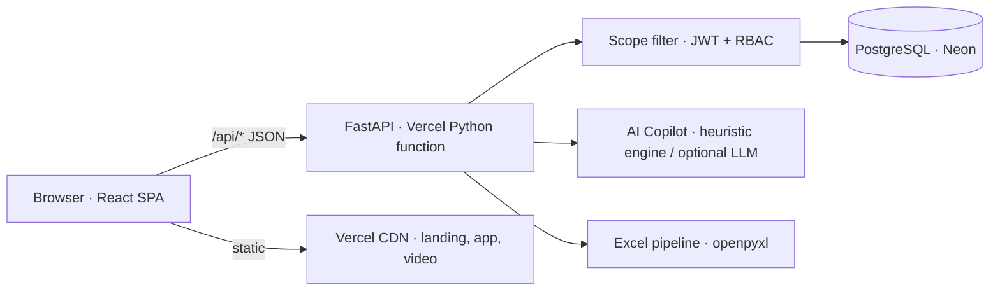

# Product Proposal
## Project: HCCDI TaskPilot — AI-Powered Task Management & To-Do Platform
**Document Version:** 1.0.0  
**Status:** Proposed  
**Audience:** Sponsors, team leads, IT/security reviewers  
**Date:** October 2026  

---

## 1. Summary

Teams that coordinate work in a shared Excel workbook pay for it every week: statuses drift ("Pending", "Under Review?", blank), nobody owns half the rows, every person can read every row, and there is no history of who changed what. **HCCDI TaskPilot** replaces that workbook with a secure, AI-assisted task workspace **without asking the team to abandon Excel on day one**: the existing sheet is imported with a validation preview, and a styled spreadsheet can be exported back at any time.

This proposal asks for approval to run TaskPilot as the team's task system of record, hosted on Vercel with a managed PostgreSQL database (Neon).

| | |
|---|---|
| **What it is** | Web app (React SPA + FastAPI API + PostgreSQL) |
| **Who it is for** | Admins (team leads, ops managers) and users (individual contributors) |
| **Core promise** | Spreadsheet in, secure AI workspace out |
| **Live demo** | Landing page `/`, demo accounts on `/login` (see [User Manual](./12_USER_MANUAL.md)) |
| **Launch video** | `frontend/public/media/taskpilot-tour.mp4` (20 s), embedded on the landing page |

---

## 2. Problem

| Pain in the shared workbook | Consequence |
|---|---|
| Everyone sees every row | Confidential or personal work is exposed to the whole team |
| Free-text statuses and priorities | Reports disagree; "Pending" and "To Do" are counted separately |
| Rows without owners or titles | Work silently falls through the cracks |
| No audit trail | Nobody can tell who changed a deadline or closed a task |
| No planning help | People decide what to do next by scrolling |

## 3. Proposed solution

### 3.1 Capabilities (all implemented in this repository)

1. **Excel round-trip.** Upload `.xlsx`, review a dry-run preview (legacy statuses mapped, rows missing a title held back), commit; export back to `.xlsx` with native dropdown validation on status and priority.
2. **Isolated workspaces.** Every task query passes through one scope filter. Users see only tasks they created or are assigned to (or that belong to projects they are members of); a probe for anyone else's task ID returns **404**, not 403, so existence isn't leaked. Admins see the whole organisation.
3. **AI Task Copilot.** Turn a sentence into a structured task (title, priority, due date, checklist), break work into subtasks, explain a priority, plan the day, and answer questions about *your own* tasks. A deterministic engine works fully offline; an LLM key can be added for richer output.
4. **Four ways to work.** Dense list with bulk actions, drag-and-drop Kanban, monthly calendar, and a slide-over task drawer with checklist, comments and activity log; global `Ctrl/⌘ K` command palette.
5. **Governance.** Admin user provisioning and role management, organisation-wide audit trail, productivity analytics.

### 3.2 Why this approach

- **Low switching cost:** the import/export loop lets the team migrate gradually and keep stakeholders who still want a spreadsheet.
- **Security by construction:** isolation lives in the data-access layer (`apply_task_scope`), not in UI hiding, and is covered by automated tests.
- **No vendor lock on AI:** the Copilot runs without any API key; an LLM provider is optional.

## 4. Scope

**In scope for rollout:** the capabilities above, demo data, Vercel deployment, documentation (this suite).

**Out of scope (candidate follow-ups, not built):** email/Slack notifications, SSO/SAML, recurring-task automation UI, mobile apps, multi-organisation tenancy.

## 5. Users and roles

| Role | Can | Cannot |
|---|---|---|
| **Admin** | See and edit every task; provision users and roles; read the audit trail and org analytics | — |
| **User** | Create tasks; work on tasks they own, are assigned, or share through a project | See other people's tasks (404), access admin pages (403) |

## 6. Architecture at a glance

Details: [System Design & Architecture](./04_SYSTEM_DESIGN_ARCHITECTURE.md), [Backend Schema](./09_BACKEND_SCHEMA_SPEC.md), [Deployment Guide](./13_DEPLOYMENT_GUIDE.md).

## 7. Rollout plan

| Step | Outcome | Owner |
|---|---|---|
| 1. Deploy | Vercel project + Neon database, secrets set, demo seed loaded | Engineering |
| 2. Pilot | One team imports its workbook via the preview, runs on TaskPilot for two sprints | Team lead |
| 3. Review | Compare against the success measures below; fix gaps | Team lead + Engineering |
| 4. Expand | Provision remaining users; retire the shared workbook (export kept as archive) | Admin |

## 8. Success measures (targets to agree with the sponsor)

These are proposed targets, not measured results:

- 100% of active work items live in TaskPilot by the end of the pilot; the shared workbook becomes read-only.
- 0 cross-user data exposures (verified by the isolation test suite on every change).
- Every task has an owner and a valid status after import (enforced by the preview).
- Weekly stakeholder reports produced from the Excel export instead of hand-edited sheets.

## 9. Risks and mitigations

| Risk | Mitigation |
|---|---|
| Default secrets reach production | Startup fails on Vercel if `JWT_SECRET_KEY` is the public default; see the deployment guide |
| Messy legacy sheets | Dry-run preview; rows missing a title are held back, statuses normalised |
| AI output quality without an LLM key | Deterministic engine is predictable; drafts are always editable, never auto-committed |
| Serverless cold starts | Single lightweight function, NullPool against Neon's pooler; static assets on the CDN |
| Adoption | Excel export stays available; landing page and 20 s video explain the product |

## 10. Cost model

Hosting runs on two managed services, each with a free tier suitable for a pilot: **Vercel** (frontend + Python function) and **Neon** (PostgreSQL). Paid tiers are only needed for production-scale traffic or team features; check both vendors' current pricing before the expansion step. An LLM provider is optional and billed by usage if enabled.

## 11. Decision requested

Approve the pilot (steps 1–3) with one team, using the deployment described in [13_DEPLOYMENT_GUIDE.md](./13_DEPLOYMENT_GUIDE.md).
