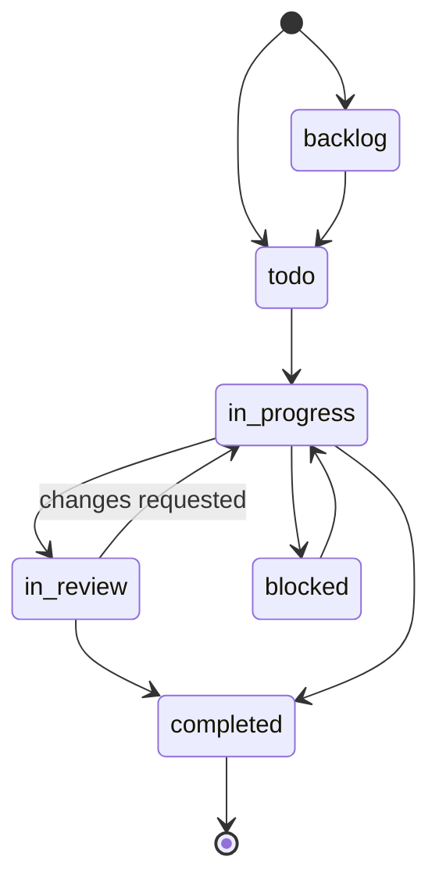
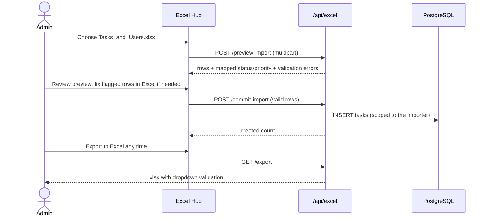
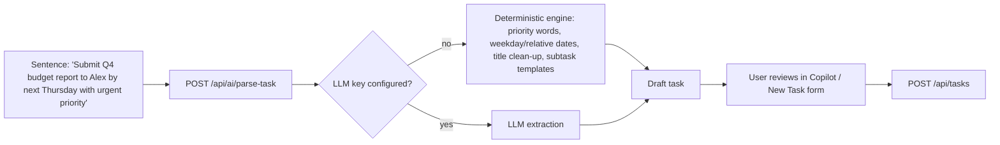
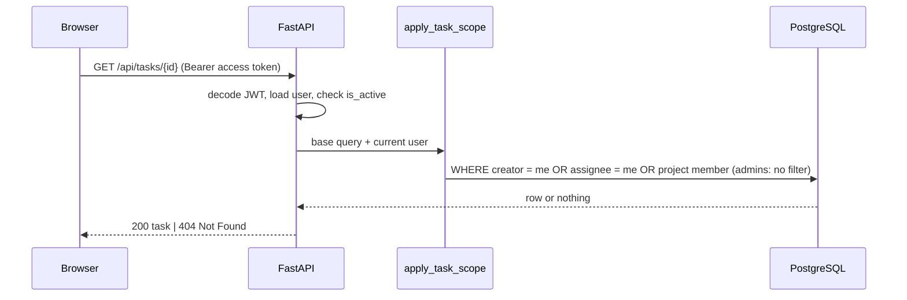
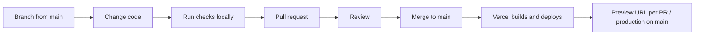

# Workflows
## Project: HCCDI TaskPilot
**Document Version:** 1.0.0  
**Status:** Current  
**Date:** October 2026  

This document describes how work moves through TaskPilot — for the people using it and for the engineers changing it. Every flow below matches the shipped code; file references point at where each step lives.

---

## 1. Task lifecycle



- Any status can be set directly from the list's status dropdown, the drawer, or by dragging a Kanban card.
- Every change writes an immutable entry to `task_activity_logs` (`log_task_activity` in `backend/app/services/task_service.py`), visible in the drawer's **Audit Log** tab and the admin **Audit Trail**.
- Moving a task to **Completed** stamps `completed_at` and triggers a confetti celebration on the board.
- **Delete** archives the task (`is_archived = true`); archived tasks disappear from every view.

## 2. Onboarding a team from Excel



Rules applied during preview (`backend/app/services/excel_service.py`):

| Input | Becomes |
|---|---|
| `Pending`, `To Do` | `todo` |
| `Under Review` | `in_review` |
| `In Progress`, `Blocked`, `Completed`, `Backlog`, `In Review` | same value, snake_case |
| unknown status | `todo` |
| unknown priority | `medium` |
| empty title | row held back with an error |

## 3. Daily work (individual contributor)

1. Sign in → **Task List** shows your scoped tasks.
2. Press `Ctrl/⌘ K` to jump to a task or start a new one.
3. **AI Copilot → Plan my day** orders today's work by due date and priority.
4. Open a task → tick checklist items, comment, or **Explain Priority** for the AI's reasoning.
5. Drag cards across the **Kanban Board** as work progresses; check the **Calendar** for upcoming deadlines.

## 4. Capturing work with the AI Copilot



The draft is never saved automatically; the user confirms it. All Copilot calls are logged in `ai_interactions` and only read tasks inside the caller's scope.

## 5. Isolation check (what happens on every request)



Access tokens expire after 60 minutes; the frontend's Axios interceptor queues requests, calls `POST /api/auth/refresh`, rotates both tokens and retries. Refresh tokens are single-use and stored only as hashes.

## 6. Administration

| Goal | Where |
|---|---|
| Add a person | **Team & Roles → Provision User** (name, email, password, role) |
| Change a role or deactivate | API only for now: `PUT /api/admin/users/{id}` with `role` / `is_active` (try it from Swagger at `/docs`) |
| Review changes | **Audit Trail** (latest 100 events across the organisation) |
| See workload | **Productivity Analytics** → organisation workload distribution |

## 7. Engineering workflow



Local checks before every push:

```bash
# backend (needs a Postgres URL; see docs/13_DEPLOYMENT_GUIDE.md §2)
cd backend && python -m pytest tests -q          # 21 tests: auth, isolation, AI, Excel

# frontend
cd frontend && npx tsc --noEmit && npm run build
```

Conventions:
- **Schema changes** go in a new numbered file under `backend/migrations/`; keep `scripts/seed_demo.py` idempotent.
- **New endpoints touching tasks** must load rows through `get_scoped_tasks_query` / `get_task_or_404`, and add a test proving another user gets 404.
- **UI work** follows `PRODUCT.md` (product context) and the Impeccable surface brief in `.impeccable/surfaces/` for the landing page.
- **Knowledge graph:** after larger changes run `graphify update .` to refresh `graphify-out/` and the Obsidian vault (see README).

## 8. Release workflow

1. Merge to `main` → Vercel production deploy.
2. Smoke test: `GET /api/health` returns `"status": "healthy"`; sign in with each demo account; switch to Sarah and confirm Alexander's tasks are absent.
3. If the schema changed, apply the new migration to Neon before merging (see deployment guide §5).
4. Roll back from the Vercel dashboard (**Deployments → … → Promote** a previous build) if needed; the database is not rolled back automatically.
